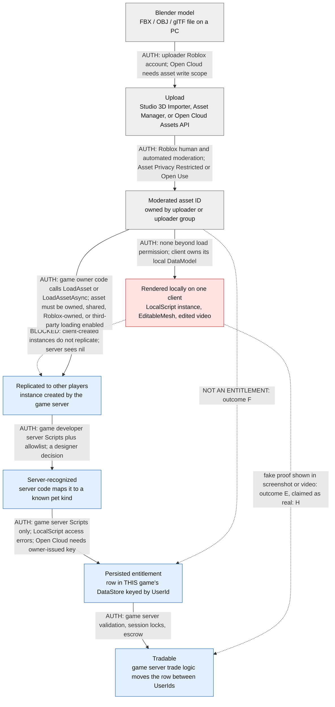

# 04 — External Asset Import: Reality Check

Execution date: 2026-10-19. Read-only, defensive. Pairs with `05_SECURE_ARCHITECTURE.md` (§10 asset governance) and
`06_TEST_PLAN.md`. Evidence IDs (`IMP-`, `OFF-`) refer to `01_EVIDENCE_LEDGER.csv` at its current values, including the
`verification_basis` column and the post-mortem confidence levels.

**Source provenance.** Every doc quote here is verbatim from the official Roblox docs source repo `github.com/Roblox/creator-docs`
at commit `70a0110` (2026-10-17), which is what create.roblox.com/docs renders. I re-checked each quote with grep for this
document. create.roblox.com itself was unreachable (proxy 403), so the URLs below are the canonical pages. They were **not** live-checked.
DevForum, wiki and third-party items come from **search snippets only** (`verification_basis = search-snippet-only`) and are marked as such.

---

## Hero answer

Uploading a Blender model to Roblox creates a **moderated cloud asset ID owned by the uploader**. It does **not** create a pet in anyone
else's game. In a pet game, a pet is a record that the game's own server writes into **that game's** DataStore, keyed by UserId. Only that
game's server Scripts can write the record. An asset ID does not create it, and neither does a catalog purchase, a model on your own client,
or a copied place file. External import can put a lookalike model on your own screen, in your own place, or in a video. It cannot reach a
third-party game's server, its DataStore, or its trade system. The only legitimate way an external asset becomes a pet is that **the
game's developers write server code that recognises it**.

- **Can:** upload `.fbx` / `.obj` / `.gltf` models and get an asset ID after moderation (IMP-001, IMP-003, IMP-004) → outcome **F**.
- **Can:** render any model you are allowed to load on your *own* client, or edit video or screenshots. Nobody else's server sees it (IMP-009, OFF-002) → **E**.
- **Cannot:** make another creator's game load your asset. Loading needs ownership, a share or grant, or the owner turning on third-party loading. Even then, the game's own code has to make the call (IMP-006, IMP-007, OFF-032/033) → **F**.
- **Cannot:** write another game's DataStore. Access is server-only and scoped to that game. Open Cloud access needs the owner's API key (IMP-010/011, OFF-031).
- **Real risk is the reverse direction.** A developer who inserts a backdoored model, or gives out Edit access or an Open Cloud key, hands *server* power to someone else. That person can then mint items (**C**) (IMP-025, OFF-035, OFF-031).

---

## 1. Chain diagram: where rendering diverges from a server-authorized grant

**The divergence boundary is the D → E edge, and above all the E → F edge.** Everything up to C is a platform content fact owned by
the uploader. D is what one client draws for itself. From F onward, everything happens because **the game's own server code chose to
do it**. No hop from C or D into F, G or H is available to a third party through the asset system. Each of those hops is a server
decision inside the game's trust boundary.

Supporting quotes (canonical URLs; verified in creator-docs@70a0110):
- "Instances are server-authoritative, meaning that for an instance to replicate between all participants (the server and all connected
  clients) it must be created on the server." — https://create.roblox.com/docs/scripting/security/access-control (OFF-002)
- "if you create a part in a `LocalScript` and try to pass it to a `Script`, the server will see `nil` because the part isn't replicable
  for the server." — https://create.roblox.com/docs/scripting/events/remote (OFF-002)
- "The server can only access data stores through `Scripts`. Attempting client-side access in a `LocalScript` causes an error." —
  https://create.roblox.com/docs/cloud-services/data-stores (IMP-011)

Outcome mapping: stop at C = **F**. Stop at D (screenshot or video) = **E**. Presenting C or D as a real owned pet = **H**. F→G→H run by
the game's own server is **A/B**. Reaching F or G by any other route requires a server compromise (**C**) or a replayed grant (**D**).
No such route via asset import was found (IMP-017, IMP-024: searches found nothing).

---

## 2. Import mechanisms

Outcome codes follow the brief: A legit server pet · B legit pet without direct Robux · C unauthorized server-issued · D dup/replay ·
E client-only spoof · F external asset, not an entitlement · G compromised/reversed · H unverified/fabricated.

| Mechanism | Who can do it | Where it lands | Replicates? | Can it create an inventory entitlement in a third-party game? (doc quote + URL) | Outcome |
|---|---|---|---|---|---|
| **3D Importer** (Studio) | Any Studio user | Uploader's cloud assets, and into the place they have open | Only inside *their own* place, if their server holds it | **No.** "When you upload or import a `.gltf`, `.fbx` and `.obj` model file to the cloud using the Importer, Roblox represents it as a cloud-based asset with a unique corresponding ID." An ID is content, not a DataStore row. https://create.roblox.com/docs/parts/models (IMP-001) | F |
| **Asset Manager** (bulk import) | Any Studio user / group member with permission | Uploader or group assets | Same as above | **No.** The same asset system applies. If the asset is still in moderation, "users cannot see or interact with the asset until Roblox approves it." https://create.roblox.com/docs/projects/assets (IMP-004) | F |
| **Open Cloud Assets API** | Holder of an API key with `asset:write` | Key owner's or group's assets ("Models upload as packages") | N/A until some game loads it | **No.** The API returns an asset ID and a moderation state. No DataStore of another game is touched. https://create.roblox.com/docs/cloud/guides/usage-assets (IMP-003) | F |
| **Toolbox / Creator Store** | Anyone can publish; *a developer* chooses to insert | Inside the inserting developer's place | Yes, if inserted into server-side containers | **Not directly.** It becomes dangerous only when a developer inserts it: "they can contain malicious scripts called backdoors. These scripts give their creators unauthorized server-side access to your game". https://create.roblox.com/docs/scripting/security/third-party-vulnerabilities (IMP-025, OFF-035) | F normally; **C** if a backdoor runs |
| **Packages** | Owner / group with edit rights | Places that contain the PackageLink | Yes, as part of that game | **Only for the game that includes it.** "Be careful when inserting assets that you didn't create into your games, as they can contain malicious scripts." https://create.roblox.com/docs/projects/assets/packages (IMP-026) | F; C if a trusted package is altered and AutoUpdate pulls it |
| **UGC catalog (Marketplace)** | ID-verified + Roblox Plus/Premium creators; 80 Robux upload fee (500 with emissive mask) | Buyer's **Roblox avatar inventory** | N/A | **No**, unless the game's code checks ownership itself. `PlayerOwnsAssetAsync`: "Returns whether the given user has the given asset." That is a platform fact, and it only becomes a game item if that game's server maps it. https://create.roblox.com/docs/reference/engine/classes/MarketplaceService · https://create.roblox.com/docs/marketplace/marketplace-fees-and-commissions (IMP-013, IMP-015) | F; C only if a game maps catalog IDs loosely (IMP-014) |
| **`InsertService:LoadAsset`** | The **game's own server code** | That game's DataModel | Yes, when the server parents it | **No for third parties.** "To load an asset, it must be accessible by the creator of the experience loading it". The asset must be created or owned by the game creator, shared by its owner, or Roblox-owned (plus OpenUse clothing and accessories). https://create.roblox.com/docs/reference/engine/classes/InsertService (IMP-006, OFF-032) | F |
| **`AssetService:LoadAssetAsync`** | The game's own server code | That game's DataModel, as a sandboxed Model | Yes, when the server parents it | **No for third parties.** "the modern replacement for" LoadAsset. Third-party free Store assets load only if the owner turns on **Allow Loading Third Party Assets**. "the returned `Model` is sandboxed by default". https://create.roblox.com/docs/reference/engine/classes/AssetService (IMP-007, OFF-033) | F |
| **EditableMesh / `CreateMeshPartAsync`** | The game's code; EditableMesh needs the owner's **Enable Mesh / Image APIs** toggle | Runtime mesh in that game | EditableMesh is `NotReplicated`. A MeshPart that the server creates replicates | **No.** "For security purposes, using `EditableMesh` fails by default in published games". It loads only meshes owned by or shared with the game owner, the Studio user, the client player, or a permitted group. https://create.roblox.com/docs/reference/engine/classes/EditableMesh (IMP-008) | E (client) / F |
| **Client-side local instance** | Any client, including a modified one | That one client's local DataModel | **No** | **No.** Exploiters can "Change anything in their local DataModel without firing any expected events". The server still sees `nil`. https://create.roblox.com/docs/scripting/security/security-tactics (IMP-009, OFF-002) | E |
| **saveinstance / copied place** | Any client of a game | Attacker's local file and their own place | Only in their copy | **No.** "Any content that replicates to a client can be extracted and data-mined by an exploiter." But content in ServerStorage and ServerScriptService "cannot be decompiled". DataStores don't travel with a place copy. https://create.roblox.com/docs/scripting/security/access-control (IMP-021, IMP-022 snippet-only) | E in copy / H if claimed real |
| **Private / uncopylocked copies, lookalike games** | Anyone who builds or republishes a lookalike | A *different* universe with its own DataStores | Within that universe only | **No.** "Data stores are consistent per game". A lookalike game's store is not the original's. https://create.roblox.com/docs/cloud-services/data-stores (IMP-011; IMP-019 PLAUSIBLE, snippet-only) | E/F; H (and often phishing → G) |

Note: `require(assetId)` and `LoadAsset` of unowned assets are gated by the `LoadUnownedAsset` Script Capability ("Allows a script to
`require()` asset IDs or call `InsertService:LoadAsset()` for assets not owned by the creator";
https://create.roblox.com/docs/reference/engine/enums/SecurityCapability). They are also on the Creator Store's restricted list (§5).

---

## 3. Legitimate routes for a pet asset to become a pet in a game

Every route goes **through that game's own server code**. None of them can be triggered from outside.

1. **The developer adds it to the catalog.** The studio's artists upload the model under the studio's account or group. A developer
   adds `kindId → asset` to the server catalog, and the server grants that kind through earn, hatch, purchase or trade paths (A/B). This is
   how Adopt Me!-style pets work. No evidence was found that Adopt Me! has a player pet-import feature (IMP-017, UNVERIFIED-absent:
   searches found only licensing news and spam).
2. **A game-designed creation feature.** Roblox supports in-experience creation: "you can enable users to create custom creatures as
   pets in your game, and allow them to save their favorite pets to their inventories". It is invoked by "`AssetService:PromptCreateAssetAsync()`
   ... in a server-side script". "Currently, you can only allow users to create packages from your game. These packages can't contain
   any scripts or private assets". All creations go through asset moderation. https://create.roblox.com/docs/projects/assets/in-experience-asset-creation
   (IMP-016). The game decides what a creation is worth in its own economy, still through server code.
3. **Mapping catalog ownership with `PlayerOwnsAssetAsync`.** A game can choose to grant an in-game pet to anyone who owns catalog asset
   X, for example a promo or a UGC tie-in (IMP-013).
   **Risk (IMP-014, PLAUSIBLE analyst inference, no incident found):** if the mapped ID list is wrong, too broad, or built from
   client-supplied IDs, anyone who publishes or acquires a matching asset mints the pet. Mitigations:
   - map only IDs created by our own user or group, in a server-side constant allowlist;
   - check on the server only;
   - make the grant idempotent (`mintRef = "CatalogOwn:<assetId>:<userId>"`) and record it in the ledger like a purchase;
   - decide in advance what happens when ownership is revoked. Roblox auto-revokes CS-refunded avatar items (OFF-020), so re-check
     ownership and mark the pet non-tradeable, or quarantine it, if ownership disappears.

---

## 4. False-claims catalogue

| Claim | Real mechanism (architecture level) | Class | Evidence quality |
|---|---|---|---|
| "Pet spawner" scripts that give you any pet | A client draws a local model or UI entry. It does not replicate and no DataStore row exists, so it vanishes on rejoin and cannot be traded. | **E** (as a demo) / **H** (as a claim of ownership) | Mechanism CONFIRMED by docs (IMP-009, OFF-002). No primary Adopt Me!/Uplift debunk post was read. Search results were dominated by SEO-spam mirror domains, which are **excluded** (IMP-029). |
| "Import any pet / upload your own model into Adopt Me!" | Uploading gives an asset ID owned by the uploader. Adopt Me!'s server never loads or grants it. | **F** (the asset) / **H** (the claim) | Platform side CONFIRMED (IMP-001, IMP-006, IMP-007). Absence of an Adopt Me! import feature is UNVERIFIED-absent (IMP-017). |
| Fake trade or "proof" videos and screenshots | Local client edits, a private copy of a leaked place, or video editing. | **E** / **H** | IMP-020 is **UNVERIFIED**: one low-authority scam list (marix.app) mentions edited screenshots, from a snippet only. Searches for Reddit/YouTube debunks returned nothing usable. |
| "Duplication / cloning service" | No asset-import path exists. These are typically scams that collect pets or credentials. | **H** (often leads to **G**) | IMP-018 STRONGLY CORROBORATED via fandom wiki/guides (snippet-only; wikis count as corroboration only). Real dupes (D) are a separate, server-bug class (OFF-005, OFF-027). |
| Lookalike "Adopt Me items" games / phishing sites | A separate universe with its own DataStore. It promises pets for Robux or passwords. | **H** → **G** | IMP-019 PLAUSIBLE (wiki snippet + a third-party URL-reputation tool; not independently verified). |
| Leaked "dev/test pets" | Would need staging content to be reachable, for example an unsecured subplace. | **H** for Adopt Me! | IMP-024 UNVERIFIED (only a 2021 low-authority snippet, not read). The generic risk is real (IMP-023). |

**Sourcing caveat.** Everything specific to Adopt Me! in this table rests on search snippets, fandom wiki text, or absence-of-evidence.
The platform mechanics are well sourced. The claim that particular videos are fake is not.

---

## 5. Real risks (where import-adjacent things *do* reach the server)

1. **Backdoored Creator Store models and `require(assetId)`.** "Roblox moderates Models for malicious scripts both proactively and in
   response to reports, but this process is not guaranteed to remove all such scripts." (third-party-vulnerabilities, IMP-025). The
   Creator Store restricts "Requiring remote assets, including `require(assetId)`, `loadstring()`, `InsertService:LoadAsset()`,
   `AssetService:LoadAssetAsync()`, and `ModuleScript.LinkedSource`. Assets that may look useful on the surface could load another
   'virus' asset at runtime." (https://create.roblox.com/docs/production/creator-store). A backdoor runs with server authority, so it can
   mint (**C**).
2. **Collaborators with Edit access.** "User has permission to edit the game." (https://create.roblox.com/docs/projects/collaboration).
   Anyone who can publish server code can mint without limit. A compromised collaborator account is a **G→C** path.
3. **Open Cloud API keys.** "An API key's access is determined by the permissions of the user who owns it." If you disable **Restrict by
   Experience**, a key gets "access to all of your user-owned games and any group-owned games where you have the appropriate permissions,
   including any games you create in the future." (https://create.roblox.com/docs/cloud/auth/api-keys, OFF-031, IMP-027). A key with
   data store write scope is an out-of-band minting capability. Open Cloud also shares the DataStore budget with live servers (OFF-024).
4. **Test places not secured within the universe.** "clients can teleport to any place within that universe ... This can also lead to the
   unintended leak of unreleased content, for example from a development or staging game." Fix: "Access Control for Places" → "Secure within
   universe only" (https://create.roblox.com/docs/scripting/security/access-control, IMP-023, OFF-010).
5. **Open Use irreversibility enables lookalikes.** "By default, Images, Decals, and Meshes are created as Open Use". "Open Use is irreversible."
   "Game grants are permanent." (https://create.roblox.com/docs/projects/assets/privacy, IMP-005, OFF-034). An Open Use pet mesh can be
   loaded by anyone to build convincing fakes (E/H) or a lookalike game. It **still** cannot grant our entitlement, but it lowers the cost of
   scams that use our brand. The launch date of the privacy system is UNVERIFIED (IMP-005).
6. **Dynamic loading from remote arguments in our own code.** "Take extreme care in dynamically loading any assets (even textures or
   sounds) or running game code (especially via require) based on the arguments of remote functions/events."
   (https://create.roblox.com/docs/scripting/security/client-server-boundary).

---

## 6. Provenance controls for OUR game

Test IDs: `T11`, `T12` and `INV-1` exist in `06_TEST_PLAN.md`. IDs marked **(proposed)** (`AP-xx`) do not exist yet and should be
added to 06 §3 (deterministic tests) or §6 (staging). Architecture references point to `05_SECURE_ARCHITECTURE.md` §10 and the §14 P0 checklist.

| # | Control | Acceptance test | Test ID |
|---|---|---|---|
| 1 | **Server allowlist of pet kinds.** `catalog.luau` (`kindId → assetRef, tradeable, rarity`) lives server-side. Mint accepts only catalog kinds and writes `mintSource` + `mintRef`. | Mint with `kind="rbxassetid://123"`, an unknown kind, or a numeric id → no pet and `mint_deny BadKind`. Every persisted pet has a valid `mintSource` and `mintRef`. | **T11**, **INV-1** |
| 2 | **Client sends kind id, never asset id.** Remote schemas accept `kindId` strings that match `^[a-z0-9_]{1,32}$` and are present in the catalog, or opaque `petId` GUIDs that the sender owns. | Fuzz every economy remote with asset-id-shaped strings, `rbxassetid://` URLs, Instances and tables → all rejected and state unchanged. | **T11**; extends T08/T09 · **AP-01 (proposed)**: schema fuzz across all remotes |
| 3 | **No third-party runtime loading.** `Allow Loading Third Party Assets` OFF, `Enable Mesh / Image APIs` OFF unless needed, no `LoadAsset`/`LoadAssetAsync`/`require(<number>)` with non-constant arguments. | CI lint fails on a dynamic `LoadAsset(`, `LoadAssetAsync(`, `require(` with a numeric or non-literal id, or `loadstring(`. A release-gate checklist screenshot or export shows both experience settings OFF in prod. | **T11** (lint part) · **AP-02 (proposed)**: settings attestation at the release gate |
| 4 | **Group-owned assets.** All pet meshes, images and packages are created under the studio group. Meshes and images are Restricted at creation where privacy opt-in is available. | Manifest check: every `assetRef` in the catalog has creator = our group id, verified by a CI script against an asset metadata export. Any user-owned or unknown-creator ID fails. | **AP-03 (proposed)** |
| 5 | **Pinned packages.** `PackageLink.AutoUpdate` stays off for production packages. Package version bumps arrive only through a PR. | CI scans the built place: any PackageLink with AutoUpdate=true, or a version that differs from the manifest, fails the build. | **AP-04 (proposed)** |
| 6 | **CI manifest hashing and place-file hash.** `assets.lock` lists `kindId, assetId, creatorId, version`. CI hashes it and the built `.rbxl`. CODEOWNERS covers the catalog and lock. The published place version is recorded against the commit SHA. Signing and attestation are our own control; Roblox provides none. | Changing `assets.lock` without CODEOWNERS approval blocks the merge. Rebuilding the same commit gives the same manifest hash. Prod place version → commit SHA lookup succeeds. | **AP-05 (proposed)** |
| 7 | **Rojo source of truth.** Code and catalog live in the repo. Rojo builds the place. CI publishes to staging and then prod via the place publishing API ("you can call this API from a GitHub action", https://create.roblox.com/docs/cloud/guides/usage-place-publishing, IMP-028). Nobody publishes to prod from Studio. | Diff a fresh Rojo build against the downloaded prod place → no script differences. Prod place version history shows only the CI identity. | **AP-06 (proposed)**; 05 §10 |
| 8 | **Open Cloud key scoping.** Separate keys per purpose, Restrict by Experience on, minimal operations and data stores, IP allowlist (except keys used inside places), expiry plus rotation, a dedicated alt account for group resources, keys stored in a secrets manager or Secrets Store. | Quarterly key inventory: each key has a purpose, scope ≤ the documented minimum, an expiry, and an owner. A staging key attempting a prod write is refused. | **AP-07 (proposed)**; 05 §9 (K1/K2) |
| 9 | **Secure subplaces.** "Secure within universe only" on prod. Staging and debug content live in a **separate universe** with separate DataStore names. The boot script asserts `game.GameId`. | From a synthetic account, a client-initiated teleport to a non-start place is refused. Prod builds contain no admin or debug remotes. | **T12** (admin remotes absent in prod) · **AP-08 (proposed)**: staging-only teleport check (06 §6 style) |
| 10 | **Third-party model hygiene.** Vet, strip scripts, and use `Sandboxed = true` with minimal Capabilities. Never grant Network, DataStore, LoadUnownedAsset/AssetRequire or LoadString to third-party content. | CI fails if any Script or ModuleScript exists under the pet-model folders. A capability audit script lists any sandboxed container with a forbidden capability. | **AP-09 (proposed)** |
| 11 | **Catalog-ownership mapping (only if ever used).** Server-only, own-group asset IDs only, idempotent `CatalogOwn:` mintRef, ledgered. | The same ownership check run twice, or on two servers, grants exactly once. An ID not in the allowlist grants nothing. | Pattern as **T13/T15**; **AP-10 (proposed)** |

Reminder from 06: a passing harness is necessary, not sufficient.

---

## 7. Could not verify

- Live create.roblox.com rendering (proxy 403). Quotes were verified against creator-docs@70a0110 only.
- Exact launch dates for glTF import (IMP-002: on or before late 2023, snippet-only) and the asset privacy system (IMP-005).
- Any primary Adopt Me! / Uplift Games statement about fake-pet videos, spawners or import. Snippets were dominated by excluded SEO spam (IMP-029).
- Whether EditableMesh requires age or ID verification to enable (snippet-only claim in `_notes/asset_import.md`; not in the doc source).
