# 05 — Secure Architecture for an Original Pet-Collection / Trading Game

Execution date: 2026-10-19. Scope: OUR OWN original Roblox experience. Everything here is defensive
design and **sandbox/reference code that has not been verified in production**. It does not describe
how to attack any live game.

---

## 0. Hero summary

**Core invariant**

> **No valid persistent pet inventory change without a uniquely traceable server-authorized source and
> reconciled ownership transition.**

In practice this breaks down into five rules:

1. **Single mint path.** A pet instance can only come into existence through `PetMint.mint()`, on the server.
   Each call takes a closed `Source` enum value and a unique `sourceRef`, such as a PurchaseId, an egg instance id,
   an event claim id, or a restore ticket id. The new pet gets a v4 UUID from `HttpService:GenerateGUID`.
2. **Grant and dedup record share one key.** A purchase grant and its `PurchaseId` record are written in the
   *same* `UpdateAsync` on the *same* session-locked profile key. Roblox never sees `PurchaseGranted`
   until that write has succeeded.
3. **No cross-key transactions, so trades are a saga.** A trade is a presumed-abort two-phase protocol. A
   trade-record key acts as the durable coordinator. Each profile step is idempotent by `tradeId`, and
   compensation and recovery run on profile load.
4. **Append-only provenance.** Every mint, transfer, revoke and restore creates an outbox entry in the same profile
   write that caused it. That entry is flushed idempotently to per-user ledger keys and exported off-platform.
5. **Least privilege everywhere.** That covers server code, admin tooling, Open Cloud keys, asset IDs (allowlisted pet
   kinds only, with no runtime loading of user-supplied asset ids), plugins, and staging and production universes.

The client is a **view and an intent source**. It never holds authority over inventory, currency,
prices, trade contents or purchase status.

---

## 1. Verified platform facts this design relies on

I could not reach `create.roblox.com` from this research environment: the egress proxy refused it with 403, and
`devforum.roblox.com` was refused the same way. Instead I read the facts below from the **official source repository
that create.roblox.com is generated from**, `github.com/Roblox/creator-docs`, at commit `70a0110` dated
2026-10-17. Each fact is cited with the create.roblox.com URL that the source file renders to. Re-check
these links in a browser before launch, because limits change.

| # | Fact (paraphrased; quotes where marked) | Source |
|---|---|---|
| F1 | `ProcessReceipt` is called for all unresolved developer-product purchases in three cases: when a purchase completes, when a successful purchase prompt appears, and **when the user joins a server**. It has **no time-based retry** and **no timeout**. It "might run on two different servers at the same time if the user joins the second server before the callback returns on the first server". It "might still fail to be recorded on the backend, even if it returns `PurchaseGranted`", in which case the purchase remains unresolved and is redelivered. Pending purchases are delivered in non-deterministic order. "Set the callback one time in a single server-side Script." If no callback is implemented, receipts are auto-acknowledged. | https://create.roblox.com/docs/reference/engine/classes/MarketplaceService#ProcessReceipt |
| F2 | **A newer API exists:** `MarketplaceService:BindReceiptHandler(receiptType, handler, filter?)` returns `Enum.ReceiptDecision.Processed` or `NotProcessedYet`. It supports `Enum.ReceiptType.DeveloperProduct` and Robux-transfer receipts. A bound handler takes precedence and falls through to `ProcessReceipt` when no handler matches. The receipt dictionary includes `PurchaseId`, `PlayerId`, `ProductId`, `CurrencySpent` and `ReceiptType`. I did **not** verify its rollout or stability status beyond the reference page, which carries no beta tag and no deprecation. `ProcessReceipt` is still documented and not deprecated. | same page, `#BindReceiptHandler` |
| F3 | Roblox's own purchase-handling guidance says to verify, award, record the `PurchaseId` and save **atomically** under a session lock. If the id is recorded but not yet saved, return `NotProcessedYet`. The simple sample on the Developer Products page **does not dedupe by PurchaseId**, so do not copy it as-is. Roblox "checks your ProcessReceipt implementation on an ongoing basis" for products that are Listed for off-game sale. | https://create.roblox.com/docs/cloud-services/data-stores/player-data-purchasing · https://create.roblox.com/docs/production/monetization/developer-products |
| F4 | `UpdateAsync` reads the value and metadata and atomically writes the callback's result. If another server wrote in between, the callback is re-run. Returning `nil` cancels the write. **The callback cannot yield.** Strings must be valid UTF-8. A single call consumes both the read and the write budget. | https://create.roblox.com/docs/reference/engine/classes/GlobalDataStore#UpdateAsync |
| F5 | Data limits: the data store name, key and scope are each at most 50 characters, and a value is at most 4,194,304 characters per key. User metadata is at most 300 characters in total. Per-key throughput is 25 MB/min read and 4 MB/min write. Experience budget for standard stores: reads `300 + 40×CCU`/min and writes `300 + 20×CCU`/min, **shared with Open Cloud**. Each request queue holds 30 requests, and beyond that requests are dropped with error codes 301–306. Storage is `500 MB + 1 MB × lifetime users`. Old versions are kept for 30 days after being overwritten. `GetAsync` caches for 4 s by default; use `UseCache=false` for verification reads. | https://create.roblox.com/docs/cloud-services/data-stores/error-codes-and-limits · https://create.roblox.com/docs/cloud-services/data-stores/versioning-listing-and-caching |
| F6 | **No cross-key atomicity:** "Keep data that must change atomically in the same key". Multi-key writes "aren't atomic across keys". | https://create.roblox.com/docs/cloud-services/data-stores/best-practices |
| F7 | Session locking: put a `LockId` in the key metadata inside the same `UpdateAsync` that loads the data. Refuse to proceed if an unexpired foreign lock is present. Refresh the lock through autosave. On load failure, mark the profile *errored* and never save it, and block purchases. | https://create.roblox.com/docs/cloud-services/data-stores/player-data-purchasing |
| F8 | `BindToClose`: "The experience server waits **30 seconds** for all bound functions to stop running before it shuts down." Bound functions run in parallel. | https://create.roblox.com/docs/reference/engine/classes/DataModel#BindToClose |
| F9 | MemoryStore holds ephemeral data that is "don't need to be durable". The memory quota is `64 KB + 1.2 KB × users`, and requests are limited to `1000 + 120 × CCU` units/min. Sorted maps and hash maps allow keys up to 128 characters, values up to **32 KB** and a maximum TTL of **3,888,000 s (45 days)**. Each sorted map or queue lives on one partition, and throttling starts around ~30k units/min per partition. A single structure is limited to 100 MB and 1M items. Queue items get an invisibility timeout, 30 s by default, and must be `RemoveAsync`-ed after processing. Sorted-map and hash-map `UpdateAsync` exist. | https://create.roblox.com/docs/cloud-services/memory-stores · …/memory-stores/sorted-map · …/memory-stores/queue · …/memory-stores/hash-map |
| F10 | MessagingService: "Delivery is **best effort and not guaranteed**." Messages are at most 1 kB. Sending is limited to `600 + 240×players` per server per minute. Messages typically arrive in 1–2 s. | https://create.roblox.com/docs/reference/engine/classes/MessagingService |
| F11 | Remote validation: type, structure and value checks are required. NaN and inf are of type `number`, so reject them with `math.isfinite`. Strings must be valid UTF-8, checked with `utf8.len`. Never accept Instances or tables where an id is expected. Use token-bucket rate limiting. Never trust `PromptProductPurchaseFinished`. | https://create.roblox.com/docs/scripting/security/client-server-boundary |
| F12 | `InsertService:LoadAsset` loads only assets created or owned by the game creator, shared by the owner, or owned by Roblox, plus OpenUse types. Free Store models require `AssetService:LoadAssetAsync` together with `AllowInsertFreeAssets`. Third-party models may contain backdoors, so sandbox them with Script Capabilities. | https://create.roblox.com/docs/reference/engine/classes/InsertService#LoadAsset · https://create.roblox.com/docs/scripting/security/third-party-vulnerabilities |
| F13 | Open Cloud API keys have scopes, some of which can be restricted to specific games. Keys support IP/CIDR allowlists and expiration dates, and a key unused for 60 days auto-expires. Use the minimum permissions. | https://create.roblox.com/docs/cloud/auth/api-keys |
| F14 | `HttpService:GenerateGUID` produces a random v4 UUID with no timestamp or ordering. | https://create.roblox.com/docs/reference/engine/classes/HttpService#GenerateGUID |
| F15 | Studio data-store access uses the same stores as the live game. "Do not enable this setting for live games. Instead, enable it for a separate test version." | https://create.roblox.com/docs/cloud-services/data-stores |
| F16 | Teleport security settings exist. Only server-side `TeleportAsync` is allowed for new work. Treat teleport data as client-visible. | https://create.roblox.com/docs/projects/teleport |

**Gaps I could not verify, so the design does not rely on them:**
- Any SLA on how quickly `ProcessReceipt` or `BindReceiptHandler` is redelivered.
- The exact behaviour of `BindReceiptHandler` when it runs concurrently on two servers. I assume it behaves like F1, at least once.
- Any strong consistency or ordering guarantee for MemoryStore beyond per-call `UpdateAsync` atomicity.
- How `DataStoreKeyInfo.UpdatedTime` relates to `os.time()` skew between servers.

---

## 2. Trust boundaries

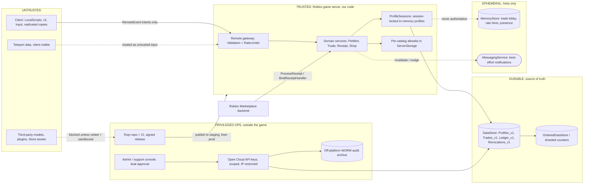

Boundary rules:

| Boundary | Rule |
|---|---|
| Client → server | The client sends intents only, such as `TradeAddPet(tradeId, petInstanceId)` or `ConfirmTrade(tradeId, offerVersion)`. Every argument is positively validated (§13.2) and rate-limited (§13.3). The server recomputes prices, ownership and trade contents from its own state. |
| Server → DataStore | All profile reads and writes go through `UpdateAsync` with a session-lock check (F4, F7). The server never calls `SetAsync` on a profile. |
| Server → MemoryStore / MessagingService | These are **never** a source of truth for ownership or balances (F9, F10). They are used for lobby lists, "trade request" pings and cache invalidation hints. Losing them may cost UX but never items. |
| Roblox → server, receipts | The only trigger for paid grants. The server never trusts the client's purchase-finished signal (F11). |
| Ops → DataStore, Open Cloud | Separate scoped keys for read-only analytics, for export, and for support writes. Support writes go through a dual-approval tool and never come from ad-hoc scripts (§8). Open Cloud shares the experience request budget (F5), so throttle it. |
| CI → servers | Only CI publishes production places. Studio "API access" is enabled on staging only (F15). |

---

## 3. Inventory data model

One profile key per user holds everything that must change atomically: pets, currency, purchase dedup, trade markers
and the outbox (F6). Separate keys hold things that are cross-user or append-only.

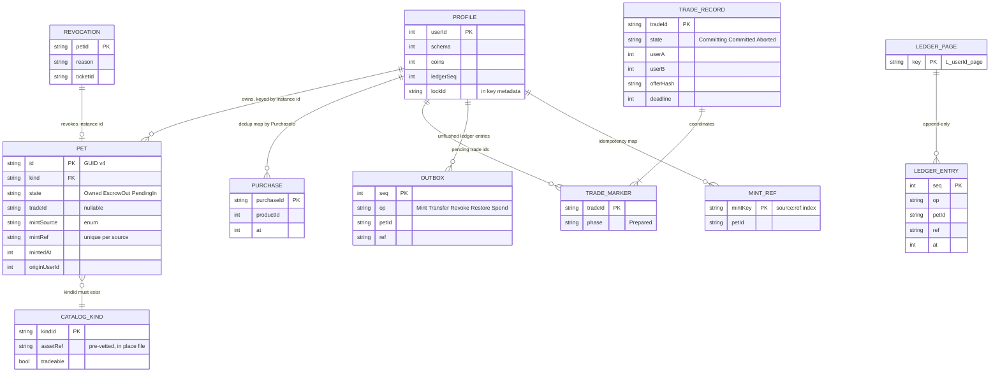

| Store (DataStore name) | Key | Contents | Writer |
|---|---|---|---|
| `Profiles_v1` | `u_<userId>` (≤ 50 chars) | Profile JSON. Session lock lives in metadata. | Session-holding game server only |
| `Trades_v1` | `t_<tradeId>` | Trade coordinator record (§6) | Game servers, through CAS-style `UpdateAsync` |
| `Ledger_v1` | `L_<userId>_<page>` | ≤ ~2,000 entries per page, append-only by convention | Outbox flusher |
| `Revocations_v1` | `r_<petInstanceId>` | Revocation tombstone and restore ticket link | Support tool only, via Open Cloud |
| `MintCount` (OrderedDataStore) | `<kind>_<shard 0..N-1>` | Sharded mint counters, summed for reconciliation | Outbox flusher, using `IncrementAsync` |

**Schema versioning:** `profile.schema` is an integer. Migrations are pure functions `vN → vN+1`. They run
inside the load transform and must be idempotent. Never downgrade: if `schema > CURRENT`, refuse to load and
treat the profile as *errored*, which blocks saves. That protects a rollback deploy from truncating newer data.

**Size budget:** the 4 MB key limit (F5) caps pets at roughly 10–15k at ~250 bytes each. Alarm at 1 MB.
The purchase map is never pruned in the MVP, because receipts can be redelivered after a "granted" return (F1).

---

## 4. Purchase / receipt flow

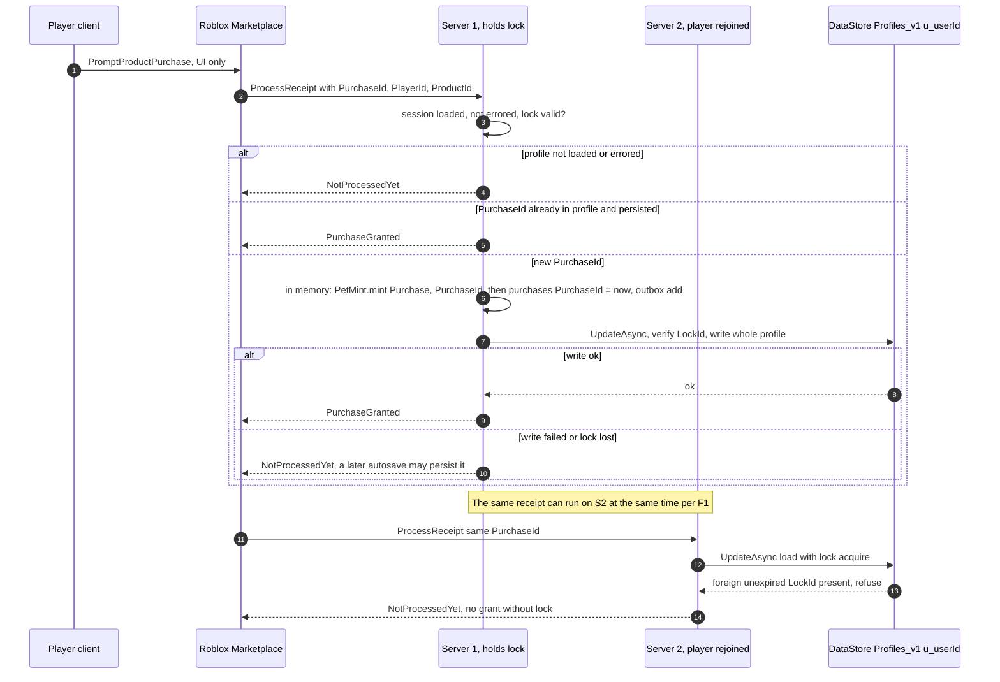

Why this is safe:

- **Dedup lives in the same key as the grant.** Under the session lock, the in-memory `purchases` map is the latest
  state (F3). Both writes land in the same `UpdateAsync`, so a grant cannot persist without its PurchaseId and vice versa.
- **A second server cannot grant.** It cannot obtain the lock, so it returns `NotProcessedYet`. If it later obtains
  the lock because the first server released it, it loads a profile that already contains the PurchaseId and returns
  `PurchaseGranted` without granting again.
- **Known residual risk: an in-session freebie.** If the save fails, the player has the item in memory for the rest of
  the session. The profile is not persisted, and the receipt is retried later (F3 warning). To limit this, `PendingIn`-style
  gating can apply to purchased pets: a pet is not *tradeable* until the purchase has been persisted. This is the
  "trade hold on newly purchased items" in §12.
- **Unknown ProductId:** return `NotProcessedYet` and page on-call. Never grant a default item.
- **`BindReceiptHandler` (F2):** the same handler body works. Map `PurchaseGranted` to `ReceiptDecision.Processed`.
  Use **one** handler per product set and never register both paths for the same product unless the
  fall-through behaviour is intended.

---

## 5. Pet minting service

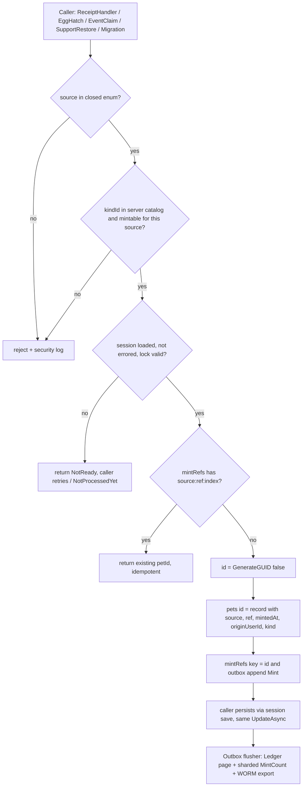

Rules:

- `PetMint.mint` is the **only** function that inserts into `profile.pets` with a new id.
  A CI grep or lint rule forbids `pets[` assignments elsewhere, except in `TradeService` transfers, which move
  existing ids, and migrations.
- `sourceRef` must be unique per source. Examples: `PurchaseId`, `eggPetId` (the egg is consumed in the same in-memory
  mutation), `eventId:userId`, `restoreTicketId`.
- Provenance is immutable. Trades move the record and append a ledger `Transfer` entry, but never change `mintSource` or `mintRef`.
- The instance id is a v4 GUID (F14). Uniqueness is probabilistic, but collisions are astronomically unlikely.
  Duplicate detection (§11) exists to catch *logic* bugs, not GUID collisions.

---

## 6. Two-party trading: escrow + saga with no cross-key transactions

### 6.1 Session state machine (in memory, one server)

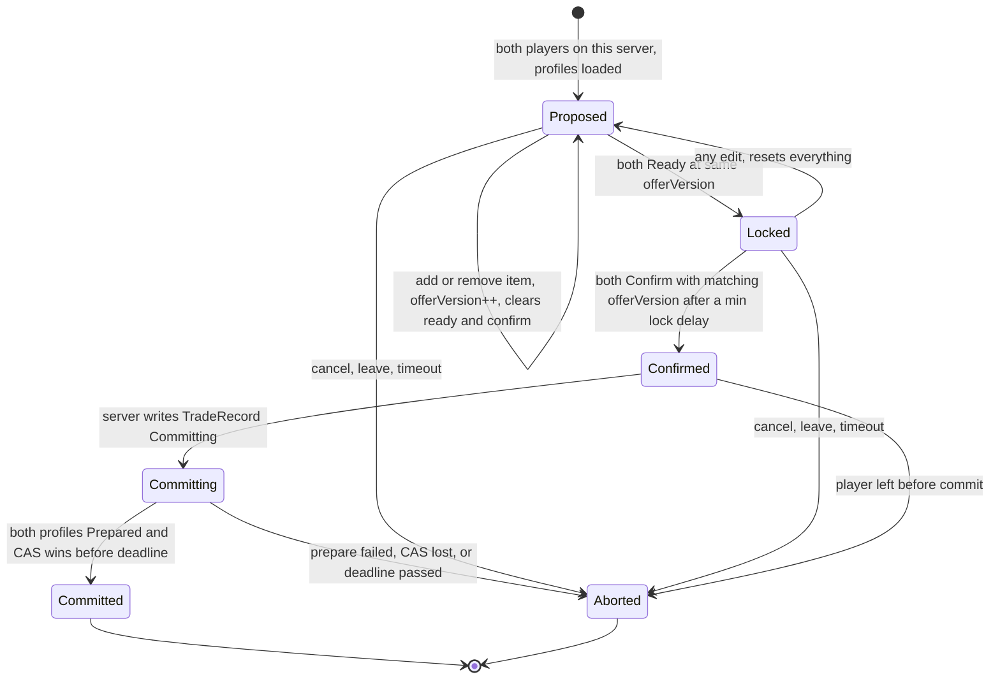

Anti-switch UX: the confirm button stays disabled for about 3 s after entering `Locked`. Confirm messages carry
`offerVersion` and are ignored if it is stale. That handles the "item changed after accept" case.

### 6.2 Durable commit protocol (presumed-abort 2PC; the trade record is the coordinator)

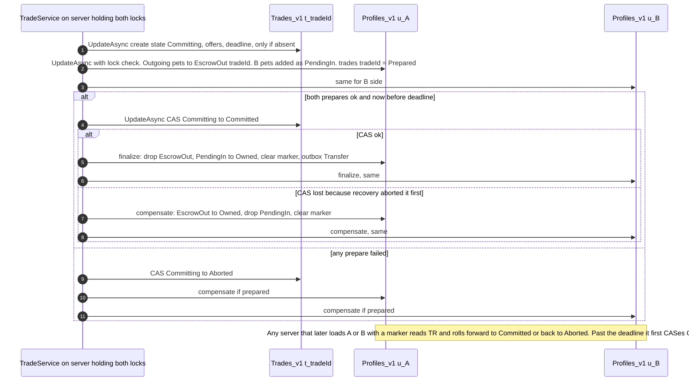

**Recovery on load (`TradeService.recover`).** This runs after the session lock is acquired and before the
profile is exposed to gameplay. For each `tradeId` in `profile.trades`:

| Trade record state | Action on this profile |
|---|---|
| `Committed` | finalize. Idempotent: if the marker is already gone, do nothing. |
| `Aborted` or missing | compensate |
| `Committing`, deadline not passed | Leave the items frozen, since they are not usable or tradeable, and re-check every 30 s. |
| `Committing`, deadline passed | CAS to `Aborted`. If the CAS shows that someone else set `Committed`, finalize instead. |

**Which invariants hold by platform atomicity, and which need application-level compensation:**

| Invariant | Guaranteed by | Notes |
|---|---|---|
| A single profile's prepare, finalize or compensate step is all-or-nothing | `UpdateAsync` on one key (F4) | Includes the lock check |
| Trade decision is unique: exactly one of Committed or Aborted | `UpdateAsync` CAS on `t_<tradeId>` | Coordinator and recovery race, and exactly one wins |
| **Both sides apply the same decision** | **Application compensation and roll-forward** | No cross-key atomicity (F6). Eventual: each profile converges on its next save or load. |
| **No pet is usable by two users at once** | **Application state gating** | Between prepare and finalize, B's pet exists in u_A as `PendingIn` and in u_B as `EscrowOut`. Neither state is usable or tradeable. The duplicate detector counts only `Owned`. |
| No pet is lost if a server crashes mid-trade | **Application recovery on load** | The marker in the profile plus the trade record. Presumed abort past the deadline. |
| Currency in trades (if allowed) | Same escrow pattern | Use `escrowCoins[tradeId]`. Never deduct before prepare. |
| Cross-server trades (out of MVP scope) | Same protocol | The coordinator can only prepare profiles it holds locks for, so each server prepares its own player and coordinates through the trade record. MessagingService is only a nudge (F10). Defer this until the same-server design is proven. |

**Teleport mid-trade:** gameplay teleports are blocked while a session is in `Locked` or later. If a player leaves anyway,
in-memory trades before `Committing` are simply dropped, because nothing persisted. At or after `Committing`, the
protocol above applies, and the destination server's load runs `recover`.

---

## 7. Audit ledger

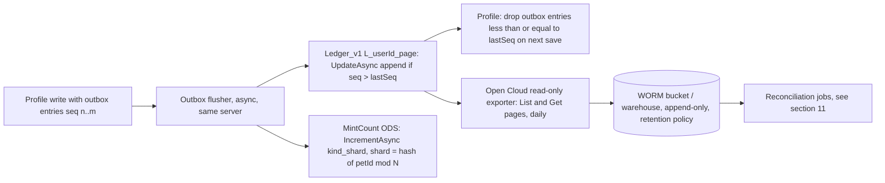

- **Append-only by convention:** DataStore entries are mutable, and versions are kept for only 30 days (F5).
  True immutability comes from the off-platform WORM export. The ledger key `UpdateAsync` refuses entries whose `seq` is
  less than or equal to the stored `lastSeq`, which makes the flush idempotent under retries and crashes.
- **Outbox pattern:** because the ledger is a different key from the profile (F6), the entry is first written *inside*
  the profile in the same `UpdateAsync` as the inventory change, then copied. A crash between the two steps loses
  nothing, because the next flush re-sends it.
- **Global mint counter:** shard it, for example N=16 per kind, to stay under per-key write throughput (F5). The counter is
  for reconciliation only and is never used for id assignment.
- **Budget:** each flush is one ledger write. Batch per player per minute, because writes compete with saves for the shared
  budget (F5).

---

## 8. Recovery and support restoration

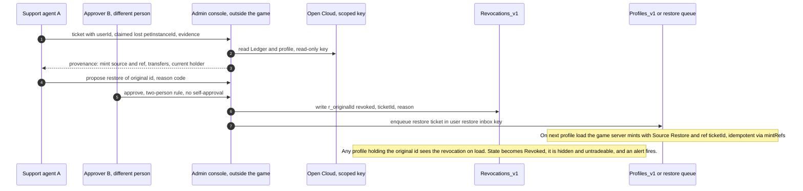

- A restore **never** writes pets directly into a live profile through Open Cloud. That would race the session lock.
  Instead, a per-user **restore inbox** key (`inbox_<userId>`) is consumed by the game server through
  `PetMint.mint(Restore, ticketId)`, so it goes through the single mint path.
- **Restore revokes the original instance id.** That prevents the classic "report as lost, get it back, and the
  original also still circulates" duplication.
- Restore volume per agent per day is capped, and spikes alert (§11).
- Rollback of a whole profile uses DataStore versioning (`GetVersionAsync`) with the same dual approval. Every pet
  that was traded away *after* the rollback point must be revoked or reconciled. The tool computes this from the ledger.

---

## 9. Permissions and admin least privilege

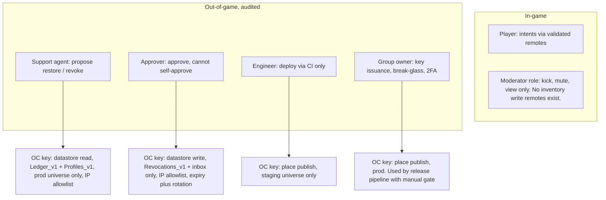

- **No in-game admin inventory commands in production builds.** Admin remotes do not exist in prod places; they are
  stripped by the CI build profile. If a moderation remote is needed, it checks the role server-side using group rank from a
  server-side lookup, never a client claim, and is rate-limited and logged.
- The Roblox group uses separate roles for "Place publish (staging)" and "Place publish (prod)". Keep prod publish to two or three people.
- Open Cloud keys are scoped per purpose, restricted to the minimum datastores and game, IP-restricted when used outside
  Roblox, and given an expiry and rotation (F13). Keys never go in places; use Secrets for any key a game server needs.
- Dual approval and immutable audit apply to restore, revoke, rollback, catalog changes and price changes.

---

## 10. Asset pipeline governance

```mermaid
flowchart LR
  Art["Artist source files"] --> Rev["Asset review: no scripts in pet models"]
  Rev --> Up["Upload under the GROUP account"]
  Up --> Cat["catalog.luau in Rojo repo: kindId, assetRef, tradeable, rarity"]
  Cat --> PR["PR: 2 reviewers, CODEOWNERS on catalog + economy modules"]
  PR --> CI["CI: selene + luau-analyze strict, unit tests, catalog lint, no InsertService of dynamic ids"]
  CI --> Stg["Publish to STAGING universe"]
  Stg --> QA["Test plan 06 in staging, synthetic accounts"]
  QA --> Gate["Manual release gate"]
  Gate --> Prod["Publish to PROD universe"]
  Plug["Studio plugins"] -. "vetted allowlist, pinned versions, script capabilities" .-> Rev
```

- **The server catalog is the allowlist.** Pets are identified by `kindId`, such as `"fox_basic"`, never by a raw asset id from
  the client. Pet models are pre-placed in `ServerStorage` or `ReplicatedStorage` in the place file, so normal gameplay needs no runtime `LoadAsset`.
- **No runtime `LoadAsset` or `LoadAssetAsync` of client-supplied ids.** A CI rule fails the build on
  `InsertService:LoadAsset(` with a non-constant argument. `AllowInsertFreeAssets` stays off (F12).
- An uploaded mesh or model is **not an entitlement**. A visually identical model in a player's own place cannot be
  part of our inventory, because the inventory is a server-side record keyed by `kindId` and instance id.
- Third-party models are allowed only when vetted, sandboxed with Script Capabilities, and stripped of scripts where possible (F12).
- Use Rojo for code-as-source, with branch protection and signed commits recommended.
- Staging and prod are **separate universes** with separate data stores. Studio API access is enabled on staging only (F15).
- Test environments never call third-party production systems.

---

## 11. Observability and anomaly detection

| Detector | Signal | Data source | Action |
|---|---|---|---|
| Mint vs receipt reconciliation | `count(Mint where source=Purchase)` vs PurchaseIds in ledger vs Roblox sales reports, per product per day. These should match 1:1. | Ledger export; Creator Hub sales and Open Cloud where available | Mismatch above threshold pages on-call |
| Mint vs counter | Sum of `MintCount` shards vs ledger Mint count | ODS + export | Detects flush bugs or a mint path that bypassed the outbox |
| Duplicate instance id | The same `petId` in `Owned` state in more than one profile, or Owned while revoked | Nightly scan of exported profiles and ledger | Freeze both copies for review. Never auto-delete. |
| Unknown provenance | A pet whose `mintRef` does not exist in the ledger, or a source outside the enum | Profile scan | High severity: possible bypass of the mint path |
| Trade cycles | A→B→C→A within a short window, value flowing to one hub | Ledger transfer graph | Review queue, possibly laundering or a mule ring |
| Alt clusters | Many new accounts trading high-value items into one account | Account age, trade graph | Account-age gates (§12). Review. |
| Restoration spikes | Restores per agent, per day, per kind | Support tool log | Cap plus alert. Insider risk control. |
| Stuck trades | `Committing` older than 2× deadline | `Trades_v1` sample, or a counter in memory | Indicates recovery bugs |
| Receipt latency | Share of receipts returning `NotProcessedYet`, and time-to-grant | Server metrics | Detects DataStore throttling and lock contention |
| Remote abuse | Rate-limiter rejections and validation failures per remote | Server logs | Tune limits. Never auto-ban on a single signal. |

**Privacy and false positives:**
- Log UserIds and pet ids only, with no chat or free text. Configure data-store RTBF templates so per-user ledger and profile keys are
  erased on request. Keep a non-identifying aggregate for economy reconciliation.
- Families and friends legitimately trade in cycles, and siblings share devices. Treat graph signals as **review
  triggers, not verdicts**. Require human review before any punitive action, and keep an appeal path.
- Lag and disconnect patterns are normal on mobile. Never treat a disconnect during a trade as evidence on its own.

---

## 12. Economic safeguards and their UX costs

| Safeguard | What it stops | UX cost | Recommendation |
|---|---|---|---|
| Trade hold on newly purchased pets until the purchase is persisted, plus an optional N-hour cooldown | Converting chargebacks or a failed save into tradeable value | Buyers can't flip immediately, which causes frustration | Hold until persisted is P0. A time hold is optional and should be configurable per kind. |
| Value-imbalance warning, client UI driven by server-computed value bands | Scam trades against young players | Friction, and "value lists" become semi-official | Warn and require an extra confirm. Don't block. |
| Account-age and playtime gate for trading | Alt farms and fresh scam accounts | New players can't trade for a while | 3–7 days or X hours of playtime, as a tunable gate |
| Daily trade count cap per account | Bot-driven laundering | Rarely hits real players | Generous cap such as 100/day, with alert at 50 |
| Confirm delay and change-reset (§6.1) | Switch-at-last-second scams | About 3 s of extra wait | P0 |
| Trade history visible to the player | Social-engineering disputes; helps support | Little | Ship it |
| Promotion de-stacking: one active promo of a type, server-computed | Promo stacking for free mints | Fewer "combo" moments | Rules in server config only |

---

## 13. Reference Luau modules (sandbox, NOT production-verified)

> **Disclaimer:** this is typed Luau reference code written for this design review. It has not been run in a
> live game or load-tested, and it omits retries with ordered per-key queues (see Roblox's `DataStoreWrapper` pattern, F3),
> data replication, and UI. Use the test plan in `06_TEST_PLAN.md` before trusting any of it.

### 13.0 `Clock.luau`, injectable time source

```lua
--!strict
-- SANDBOX/REFERENCE. All economy modules read time ONLY through this module, so tests can swap
-- in a FakeClock (06 §4.3) and advance time deterministically. now() = wall-clock seconds
-- (persisted timestamps, lock ages, trade deadlines); mono() = monotonic seconds (in-server
-- intervals: rate limiting, confirm delay). Never persist mono() values.
export type ClockImpl = { now: () -> number, mono: () -> number }
local Clock = {}
local impl: ClockImpl = { now = os.time, mono = os.clock }
function Clock.now(): number return impl.now() end
function Clock.mono(): number return impl.mono() end
function Clock.set(newImpl: ClockImpl?) impl = newImpl or { now = os.time, mono = os.clock } end  -- tests only
return Clock
```

### 13.1 `Types.luau`

```lua
--!strict
-- SANDBOX/REFERENCE. Shared types for the economy core.
export type PetState = "Owned" | "EscrowOut" | "PendingIn" | "Revoked"
export type Source = "Purchase" | "Hatch" | "Event" | "Restore" | "Migration"

export type PetRecord = {
	id: string, kind: string, state: PetState, tradeId: string?,
	mintSource: Source, mintRef: string, mintedAt: number, originUserId: number,
	holdUntilPersisted: boolean?,
}
export type LedgerEntry = { seq: number, op: string, petId: string?, ref: string, at: number }
export type Profile = {
	schema: number, userId: number, coins: number, ledgerSeq: number,
	pets: { [string]: PetRecord },
	purchases: { [string]: number },   -- PurchaseId -> unix time; never pruned in MVP
	mintRefs: { [string]: string },    -- "source:ref:index" -> petId
	trades: { [string]: string },      -- tradeId -> "Prepared"
	outbox: { LedgerEntry },
}
-- Session = an in-memory profile held under a DataStore session lock (see SessionStore).
export type Session = {
	profile: Profile, loaded: boolean, errored: boolean,
	unsavedPurchases: { [string]: boolean },
	save: (self: Session) -> boolean,  -- UpdateAsync w/ lock check; true only if persisted
}
return nil
```

### 13.2 `Validation.luau`, positive validation

```lua
--!strict
-- SANDBOX/REFERENCE. Positive validation: accept only the exact shapes we expect.
local Validation = {}

function Validation.int(v: unknown, min: number, max: number): number?
	if typeof(v) ~= "number" then return nil end
	local n = v :: number
	if not math.isfinite(n) then return nil end          -- rejects NaN, +inf, -inf (F11)
	if n ~= math.floor(n) or n < min or n > max then return nil end
	return n
end

function Validation.str(v: unknown, maxBytes: number, pattern: string?): string?
	if typeof(v) ~= "string" then return nil end
	local s = v :: string
	if #s == 0 or #s > maxBytes then return nil end       -- byte length first (cheap)
	if utf8.len(s) == nil then return nil end            -- invalid UTF-8 can't be saved (F4)
	if pattern and not string.match(s, pattern) then return nil end
	return s
end

-- Pet instance ids are server-generated GUIDs without braces (36 chars, 8-4-4-4-12 hex).
local GUID = "^%x%x%x%x%x%x%x%x%-%x%x%x%x%-%x%x%x%x%-%x%x%x%x%-%x%x%x%x%x%x%x%x%x%x%x%x$"
function Validation.petId(v: unknown): string?
	return Validation.str(v, 36, GUID)
end

-- Arrays of ids: must be a real array (no holes, no extra keys), bounded length, unique.
function Validation.petIdList(v: unknown, maxLen: number): { string }?
	if typeof(v) ~= "table" then return nil end
	local t = v :: { [any]: any }
	local count = 0
	for k in t do
		if typeof(k) ~= "number" then return nil end
		count += 1
	end
	if count > maxLen then return nil end
	local out, seen = table.create(count), {}
	for i = 1, count do
		local id = Validation.petId(t[i])                -- t[i]==nil if holes -> rejected
		if not id or seen[id] then return nil end
		seen[id] = true
		out[i] = id
	end
	return out
end

-- Reject anything that is not exactly the expected argument count/types.
function Validation.argc(n: number, ...: any): boolean
	return select("#", ...) == n
end

return Validation
```

### 13.3 `RateLimiter.luau`, token bucket per player per remote

```lua
--!strict
-- SANDBOX/REFERENCE. Token bucket keyed by (userId, remoteName). Server-only.
local Players = game:GetService("Players")
local Clock = require(script.Parent.Clock)

type Bucket = { tokens: number, last: number }
local RateLimiter = {}
local buckets: { [number]: { [string]: Bucket } } = {}
local config: { [string]: { rate: number, burst: number } } = {
	TradeRequest = { rate = 0.5, burst = 3 },
	TradeEdit = { rate = 5, burst = 10 },
	TradeConfirm = { rate = 1, burst = 3 },
	Default = { rate = 2, burst = 5 },
}

function RateLimiter.allow(player: Player, remote: string, cost: number?): boolean
	local cfg = config[remote] or config.Default
	local perPlayer = buckets[player.UserId]
	if not perPlayer then perPlayer = {}; buckets[player.UserId] = perPlayer end
	local now = Clock.mono()
	local b = perPlayer[remote]
	if not b then b = { tokens = cfg.burst, last = now }; perPlayer[remote] = b end
	b.tokens = math.min(cfg.burst, b.tokens + (now - b.last) * cfg.rate)
	b.last = now
	local c = cost or 1
	if b.tokens < c then return false end
	b.tokens -= c
	return true
end

Players.PlayerRemoving:Connect(function(p) buckets[p.UserId] = nil end)
return RateLimiter
```

### 13.4 `SessionStore.luau`, lock transform (excerpt)

```lua
--!strict
-- SANDBOX/REFERENCE. Shows ONLY the lock check inside UpdateAsync (F4, F7).
-- Production needs ordered per-key queues + backoff (Roblox DataStoreWrapper pattern).
local HttpService = game:GetService("HttpService")
local Clock = require(script.Parent.Clock)
local SessionStore = {}
local LOCK_TTL = 6 * 60                 -- seconds; autosave every <= 3 min refreshes it
SessionStore.serverLockId = HttpService:GenerateGUID(false)

-- Returns a transform for UpdateAsync. `mutate` must NOT yield (UpdateAsync callbacks can't).
function SessionStore.lockedTransform(mutate: (any) -> any, release: boolean, out: { ok: boolean })
	return function(current: any, keyInfo: DataStoreKeyInfo?)
		out.ok = false
		local meta = (keyInfo and keyInfo:GetMetadata()) or {}
		local lockId, lockAt = meta.LockId, meta.LockAt or 0
		local foreign = lockId ~= nil and lockId ~= SessionStore.serverLockId
		if foreign and (Clock.now() - lockAt) < LOCK_TTL then
			return nil                                    -- cancel write: someone else owns it
		end
		local newValue = mutate(current)
		if newValue == nil then return nil end
		meta.LockId = if release then nil else SessionStore.serverLockId
		meta.LockAt = Clock.now()
		out.ok = true
		local userIds = keyInfo and keyInfo:GetUserIds() or {}
		return newValue, userIds, meta
	end
end
-- Note: a server that already holds data must also detect that its lock was STOLEN
-- (LockId changed since our load) and then mark the session errored instead of overwriting.
-- That check is in the caller: compare meta.LockId to our id when `foreign` and expired.
return SessionStore
```

### 13.5 `PetMint.luau`, the single mint path

```lua
--!strict
-- SANDBOX/REFERENCE. The ONLY function allowed to create pet instance ids.
local HttpService = game:GetService("HttpService")
local ServerStorage = game:GetService("ServerStorage")
local Types = require(script.Parent.Types)
local Clock = require(script.Parent.Clock)
local Catalog = require(ServerStorage.Economy.Catalog) :: { [string]: { mintableBy: { [string]: boolean }, tradeable: boolean } }

local VALID_SOURCES: { [string]: boolean } = { Purchase = true, Hatch = true, Event = true, Restore = true, Migration = true }
local PetMint = {}

local function appendOutbox(p: Types.Profile, op: string, petId: string?, ref: string)
	p.ledgerSeq += 1
	table.insert(p.outbox, { seq = p.ledgerSeq, op = op, petId = petId, ref = ref, at = Clock.now() })
end
PetMint.appendOutbox = appendOutbox

-- Mutates in memory only; the CALLER persists via session:save() in the same UpdateAsync
-- as any related record (e.g. the PurchaseId). Idempotent per (source, ref, index).
function PetMint.mint(s: Types.Session, kind: string, source: Types.Source, ref: string, index: number?): (string?, string?)
	if not s.loaded or s.errored then return nil, "NotReady" end
	if not VALID_SOURCES[source] then return nil, "BadSource" end
	local entry = Catalog[kind]
	if not entry or not entry.mintableBy[source] then return nil, "BadKind" end
	if typeof(ref) ~= "string" or #ref == 0 or #ref > 64 then return nil, "BadRef" end

	local p = s.profile
	local mintKey = source .. ":" .. ref .. ":" .. tostring(index or 1)
	local existing = p.mintRefs[mintKey]
	if existing then return existing, nil end           -- replay -> same pet, no new mint

	local id = HttpService:GenerateGUID(false)
	p.pets[id] = {
		id = id, kind = kind, state = "Owned", tradeId = nil,
		mintSource = source, mintRef = ref, mintedAt = Clock.now(), originUserId = p.userId,
		holdUntilPersisted = (source == "Purchase") or nil,
	}
	p.mintRefs[mintKey] = id
	appendOutbox(p, "Mint", id, mintKey)
	return id, nil
end

-- A pet is usable/tradeable only if Owned, not held, and not revoked (revocations applied on load).
function PetMint.isTradeable(p: Types.Profile, id: string): boolean
	local pet = p.pets[id]
	return pet ~= nil and pet.state == "Owned" and not pet.holdUntilPersisted
		and (Catalog[pet.kind] and Catalog[pet.kind].tradeable) == true
end

-- Call after a successful save to release persistence holds.
function PetMint.clearHolds(p: Types.Profile)
	for _, pet in p.pets do pet.holdUntilPersisted = nil end
end

return PetMint
```

### 13.6 `ReceiptHandler.luau`

```lua
--!strict
-- SANDBOX/REFERENCE. Dedup by PurchaseId inside the same profile (same key, same UpdateAsync)
-- as the grant. ProcessReceipt can run concurrently on two servers (F1); only the lock holder
-- can persist, so the other returns NotProcessedYet.
local MarketplaceService = game:GetService("MarketplaceService")
local Types = require(script.Parent.Types)
local PetMint = require(script.Parent.PetMint)
local Clock = require(script.Parent.Clock)

type Grant = (s: Types.Session, purchaseId: string) -> boolean   -- mutate in memory, no yield
local ReceiptHandler = {}
local products: { [number]: Grant } = {
	[0000001] = function(s, pid) return (PetMint.mint(s, "egg_fox", "Purchase", pid)) ~= nil end,
	[0000002] = function(s, pid) s.profile.coins += 1000; PetMint.appendOutbox(s.profile, "Coins", nil, pid); return true end,
}
local inFlight: { [string]: boolean } = {}

local getSession: (userId: number) -> Types.Session?   -- injected: returns only loaded+locked sessions

local function process(receipt: { [string]: any }): Enum.ProductPurchaseDecision
	local NOT_YET = Enum.ProductPurchaseDecision.NotProcessedYet
	local pid, userId, productId = receipt.PurchaseId, receipt.PlayerId, receipt.ProductId
	if typeof(pid) ~= "string" or typeof(userId) ~= "number" or typeof(productId) ~= "number" then
		return NOT_YET
	end
	local grant = products[productId]
	if not grant then warn("[Receipt] unknown product", productId); return NOT_YET end -- page on-call

	local s = getSession(userId)
	if not s or not s.loaded or s.errored then return NOT_YET end     -- not loaded or lock not held
	if inFlight[pid] then return NOT_YET end                           -- same-server concurrent call
	inFlight[pid] = true
	local p = s.profile
	local decision = NOT_YET
	if p.purchases[pid] then
		-- Already granted in this profile. Granted only if that state is persisted.
		if s.unsavedPurchases[pid] then
			if s:save() then s.unsavedPurchases = {}; PetMint.clearHolds(p); decision = Enum.ProductPurchaseDecision.PurchaseGranted end
		else
			decision = Enum.ProductPurchaseDecision.PurchaseGranted
		end
	else
		local ok = grant(s, pid)
		if ok then
			p.purchases[pid] = Clock.now()
			s.unsavedPurchases[pid] = true
			if s:save() then                                -- ONE UpdateAsync: grant + PurchaseId + outbox
				s.unsavedPurchases = {}
				PetMint.clearHolds(p)
				decision = Enum.ProductPurchaseDecision.PurchaseGranted
			end
			-- On save failure: item is visible in-session (documented residual risk) but held
			-- from trading; a later autosave persists it and the next delivery returns Granted.
		end
	end
	inFlight[pid] = nil
	return decision
end

function ReceiptHandler.start(sessionLookup: (number) -> Types.Session?)
	getSession = sessionLookup
	MarketplaceService.ProcessReceipt = process    -- set exactly once, one server Script (F1)
	-- Alternative (F2): MarketplaceService:BindReceiptHandler(Enum.ReceiptType.DeveloperProduct,
	--   function(r) return if process(r) == Enum.ProductPurchaseDecision.PurchaseGranted
	--   then Enum.ReceiptDecision.Processed else Enum.ReceiptDecision.NotProcessedYet end)
end
ReceiptHandler._process = process  -- exposed for tests
return ReceiptHandler
```

### 13.7 `TradeService.luau`, state machine and saga commit

```lua
--!strict
-- SANDBOX/REFERENCE. Same-server two-party trade. No cross-key transactions exist (F6), so
-- commit = presumed-abort 2PC with Trades_v1 as coordinator; all steps idempotent by tradeId.
local HttpService = game:GetService("HttpService")
local Types = require(script.Parent.Types)
local PetMint = require(script.Parent.PetMint)
local Clock = require(script.Parent.Clock)

type State = "Proposed" | "Locked" | "Confirmed" | "Committing" | "Committed" | "Aborted"
type Side = { userId: number, session: Types.Session, offer: { string }, ready: boolean, confirmedVersion: number? }
export type Trade = { id: string, state: State, a: Side, b: Side, offerVersion: number, lockedAt: number? }

-- Injected durable store for Trades_v1 (real impl: DataStore:UpdateAsync; tests: FakeDataStore).
export type TradeStore = { update: (key: string, fn: (any) -> any) -> (boolean, any) }

local TradeService = {}
local MAX_ITEMS, CONFIRM_DELAY, COMMIT_DEADLINE = 9, 3, 120
local store: TradeStore

function TradeService.init(s: TradeStore) store = s end

function TradeService.propose(a: Types.Session, b: Types.Session): Trade
	local function side(s: Types.Session): Side return { userId = s.profile.userId, session = s, offer = {}, ready = false } end
	return { id = HttpService:GenerateGUID(false), state = "Proposed", a = side(a), b = side(b), offerVersion = 0 }
end

local function resetConfirmations(t: Trade)
	t.offerVersion += 1
	t.a.ready, t.b.ready, t.a.confirmedVersion, t.b.confirmedVersion = false, false, nil, nil
	t.state, t.lockedAt = "Proposed", nil
end

function TradeService.setOffer(t: Trade, side: Side, ids: { string }): (boolean, string?)
	if t.state ~= "Proposed" and t.state ~= "Locked" then return false, "BadState" end
	if #ids > MAX_ITEMS then return false, "TooMany" end
	for _, id in ids do
		if not PetMint.isTradeable(side.session.profile, id) then return false, "NotOwnedOrHeld" end
	end
	side.offer = table.clone(ids)
	resetConfirmations(t)                              -- ANY change resets both sides
	return true
end

function TradeService.ready(t: Trade, side: Side, version: number): boolean
	if t.state ~= "Proposed" or version ~= t.offerVersion then return false end
	side.ready = true
	if t.a.ready and t.b.ready then t.state, t.lockedAt = "Locked", Clock.mono() end
	return true
end

function TradeService.confirm(t: Trade, side: Side, version: number): boolean
	if t.state ~= "Locked" or version ~= t.offerVersion then return false end   -- stale UI => ignored
	if Clock.mono() - (t.lockedAt :: number) < CONFIRM_DELAY then return false end
	side.confirmedVersion = version                     -- double-accept is idempotent
	if t.a.confirmedVersion == version and t.b.confirmedVersion == version then
		t.state = "Confirmed"
		task.spawn(TradeService.commit, t)
	end
	return true
end

-- Profile-local steps. Each is idempotent and keyed by tradeId; caller persists with session:save().
local function prepare(t: Trade, mine: Side, theirs: Side): boolean
	local p = mine.session.profile
	if p.trades[t.id] then return true end              -- already prepared (replay)
	for _, id in mine.offer do
		if not PetMint.isTradeable(p, id) then return false end
	end
	for _, id in mine.offer do
		local pet = p.pets[id]; pet.state = "EscrowOut"; pet.tradeId = t.id
	end
	for _, id in theirs.offer do                        -- copy record as PendingIn (NOT usable)
		local src = table.clone(theirs.session.profile.pets[id])
		src.state, src.tradeId = "PendingIn", t.id
		p.pets[id] = src
	end
	p.trades[t.id] = "Prepared"
	return true
end

local function finalize(p: Types.Profile, tradeId: string)
	if not p.trades[tradeId] then return end            -- already finalized/compensated
	for id, pet in p.pets do
		if pet.tradeId == tradeId then
			if pet.state == "EscrowOut" then p.pets[id] = nil; PetMint.appendOutbox(p, "TransferOut", id, tradeId)
			elseif pet.state == "PendingIn" then pet.state, pet.tradeId = "Owned", nil; PetMint.appendOutbox(p, "TransferIn", id, tradeId) end
		end
	end
	p.trades[tradeId] = nil
end

local function compensate(p: Types.Profile, tradeId: string)
	if not p.trades[tradeId] then return end
	for id, pet in p.pets do
		if pet.tradeId == tradeId then
			if pet.state == "EscrowOut" then pet.state, pet.tradeId = "Owned", nil
			elseif pet.state == "PendingIn" then p.pets[id] = nil end
		end
	end
	p.trades[tradeId] = nil
end
TradeService._finalize, TradeService._compensate = finalize, compensate

-- CAS on the coordinator record. Returns the state that won.
local function cas(tradeId: string, from: string, to: string): string?
	local winner: string? = nil
	local ok = store.update("t_" .. tradeId, function(rec)
		if rec == nil then winner = "Aborted"; return nil end   -- missing => presumed abort
		if rec.state ~= from then winner = rec.state; return nil end
		rec.state = to; winner = to
		return rec
	end)
	return if ok then winner else nil                     -- nil => unknown, retry later
end

function TradeService.commit(t: Trade)
	if t.state ~= "Confirmed" then return end
	t.state = "Committing"
	local deadline = Clock.now() + COMMIT_DEADLINE
	local created = store.update("t_" .. t.id, function(rec)
		if rec ~= nil then return nil end                 -- never overwrite an existing record
		return { state = "Committing", a = t.a.userId, b = t.b.userId,
			offerA = t.a.offer, offerB = t.b.offer, deadline = deadline }
	end)
	if not created then t.state = "Aborted"; return end   -- nothing persisted on profiles yet

	local okA = prepare(t, t.a, t.b) and t.a.session:save()
	local okB = okA and prepare(t, t.b, t.a) and t.b.session:save()
	local outcome: string? = nil
	if okA and okB and Clock.now() < deadline then
		outcome = cas(t.id, "Committing", "Committed")
	else
		outcome = cas(t.id, "Committing", "Aborted")
	end
	if outcome == "Committed" then
		finalize(t.a.session.profile, t.id); finalize(t.b.session.profile, t.id)
		t.state = "Committed"
	elseif outcome == "Aborted" then
		-- COMPENSATION: required because the two profile writes above are not atomic together.
		compensate(t.a.session.profile, t.id); compensate(t.b.session.profile, t.id)
		t.state = "Aborted"
	else
		return  -- coordinator unknown (DataStore down): items stay frozen; recover() resolves later
	end
	t.a.session:save(); t.b.session:save()                -- failures are healed by recover() on load
end

-- Run after acquiring the session lock, BEFORE gameplay can touch the profile.
function TradeService.recover(s: Types.Session, readRecord: (string) -> any?)
	local p = s.profile
	for tradeId in table.clone(p.trades) do
		local rec = readRecord("t_" .. tradeId)          -- use GetAsync with UseCache=false (F5)
		local state = rec and rec.state or "Aborted"
		if state == "Committing" and Clock.now() > rec.deadline then
			state = cas(tradeId, "Committing", "Aborted") or "Committing"
		end
		if state == "Committed" then finalize(p, tradeId)
		elseif state == "Aborted" then compensate(p, tradeId) end
		-- still Committing: leave frozen; caller re-runs recover on a 30 s timer
	end
end

return TradeService
```

Notes on Roblox constraints in this code:
- All time comes from `Clock` (§13.0); no module calls `os.time`/`os.clock` directly, so expiry, lock-age and
  confirm-delay logic is deterministic under test.
- `UpdateAsync` callbacks cannot yield (F4). All `mutate` and `cas` closures are pure, and saving happens outside them.
- `cas` returning `nil` means the platform call failed. The design **never guesses**: items stay frozen until a
  later recovery observes a definitive record state.
- `prepare` copies B's pet record into A's profile, which the session-lock model makes possible on the same server. For
  cross-server trades, the record must carry the pet snapshots instead, and must be validated against the ledger.

---

## 14. P0 launch-blocking security checklist

- [ ] Profiles are session-locked through `UpdateAsync` metadata. Lock-steal is detected, and a stolen session becomes errored, read-only and kicked with a message.
- [ ] An errored or unloaded profile is **never saved** and **cannot purchase**: the purchase UI is disabled and the receipt returns `NotProcessedYet`.
- [ ] `ProcessReceipt`, or `BindReceiptHandler`, is set **once**. PurchaseId dedup is stored in the profile and persisted in the same `UpdateAsync` as the grant. `PurchaseGranted` is returned only after a successful save. Unknown products are never granted.
- [ ] A single `PetMint.mint` path exists, with a CI lint against direct `pets[...] =` writes, a closed source enum, a unique `sourceRef`, GUID ids and an idempotent `mintRefs`.
- [ ] Trade uses the state machine with change-reset, confirm delay, `offerVersion` on confirm, server-side ownership checks, and the presumed-abort commit with `recover()` on every load.
- [ ] `EscrowOut` and `PendingIn` pets are unusable and untradeable. The duplicate detector counts only `Owned`.
- [ ] Every remote has an argument-count check, positive type/range/NaN/inf/UTF-8/length validation, and a token bucket. No remote accepts Instances, tables of item data, prices or quantities that the server can compute.
- [ ] No client-to-server remote can grant, set currency, or set inventory. Admin remotes are absent from prod builds.
- [ ] Outbox to ledger flush is idempotent by `seq`. A daily Open Cloud export goes to WORM storage. The mint-vs-receipt reconciliation job is live.
- [ ] `BindToClose` saves all sessions in parallel, skips queued stale writes, and finishes within 30 s (F8). Load-tested in staging.
- [ ] Staging and prod universes are separate. Studio API access is on staging only. CI-only prod publish. Open Cloud keys are scoped, IP-restricted and expiring.
- [ ] No runtime `LoadAsset` of non-constant ids. The pet catalog is server-side and allowlisted. Third-party models are vetted and sandboxed.
- [ ] Support restore uses the inbox, dual approval and the single mint path, and revokes the original id.
- [ ] Schema migrations are idempotent, and the server refuses to load a profile with a newer schema.
- [ ] The test plan in `06_TEST_PLAN.md` passes in staging. That is **necessary, not sufficient**.

## 15. Cost-sensitive MVP implementation sequence

1. **Week 1: data foundation.** Build the session-locked profile store, using Roblox's purchase-handling reference as the starting point, plus schema v1, the fake DataStore, and tests for lock, steal and BindToClose.
2. **Week 2: money path.** Build `ReceiptHandler`, `PetMint`, the outbox, and a minimal ledger flush. Add receipt replay and multi-server tests. Ship **no trading** yet.
3. **Week 3: gateway hardening.** Add Validation and RateLimiter on all remotes, the catalog allowlist, CI lint rules, and the staging/prod split.
4. **Week 4: trading, same server only.** Build the state machine, saga commit and `recover()`, plus the full fault-injection suite.
5. **Week 5: observability.** Add the export job, the mint-vs-receipt and duplicate-id reconciliations, and dashboards and alerts.
6. **Week 6+: support tooling.** Add the restore inbox, revocations and dual approval. Then add economic safeguards, starting with the hold-until-persisted rule, then account-age gates and imbalance warnings.
7. **Later, only if needed:** cross-server trading using MemoryStore for lobby discovery and MessagingService for nudges, with the durable coordinator unchanged.

Cheapest wins first: dedup-in-profile, session locks, single mint and positive validation cost very little and close
the highest-impact classes, which are outcomes C and D in the brief's ontology.

---

## § Addendum (post-research)

Added 2026-10-19 after the evidence ledger and the attack-surface review (`03_ATTACK_SURFACE_MATRIX.md`, rows ASM-nn).
These sections close gaps that sections 1–15 above do not cover. Ledger IDs are listed in brackets. Everything here remains
**sandbox/reference design that has not been verified in production**. Items marked *verify in staging* rest on documented
facts whose exact runtime behaviour we have not observed.

New platform facts used here (all from the creator-docs source at commit 70a0110, per `_notes/official_platform.md`):

| # | Fact | Ledger |
|---|---|---|
| F17 | The **Transaction Refunded** webhook covers developer products, passes, private servers and paid access, but not subscriptions. For passes and avatar items refunded by Customer Service, Roblox revokes ownership automatically. For developer products, "you need to use this notification to remove the granted benefit ... yourself." The payload carries the buyer, product, amount, universe/place, "transaction or receipt ID" and refund time. Signing uses an HMAC-SHA256 `roblox-signature` header; the docs suggest a ~10-minute replay window. Delivery retries 5 times, and duplicates are possible. In group-owned games, only group owners can configure webhooks. | OFF-020, OFF-021 |
| F18 | `PromptRobuxTransferAsync(sender, receiverUserId, amount)` is server-initiated, available to Roblox Plus subscribers, for 10–500 Robux. The game earns 10%. Receipts go to both sides (`RobuxTransferSender` / `RobuxTransferReceiver` through `BindReceiptHandler`) and may be delayed by parental consent. Cross-game pass and product sales were disabled from 2026-05-30. | OFF-015, OFF-016, OFF-017 |
| F19 | `PolicyService:GetPolicyInfoForPlayerAsync` returns `IsPaidItemTradingAllowed` and `ArePaidRandomItemsRestricted`. When trading is not allowed, the creator "must not allow them to access the ability to trade the resulting outcome of a paid random item or other paid items". "Hatch an egg for a pet" is a listed paid-random-item example, and the rule extends to purchases made indirectly through Robux-bought currency. | OFF-036, OFF-037, OFF-038 |
| F20 | `Player:IsVerified()` (server-only; false in Studio), `Player.AgeChecked` (an `Enum.AgeCheckStatus` set by the server) and `Player:PromptAgeCheck()` exist. There are account tiers Kids / Select / Roblox. | OFF-039, OFF-040 |

### A.1 Refund clawback via the Transaction Refunded webhook (ASM-09, ASM-19, ASM-39)

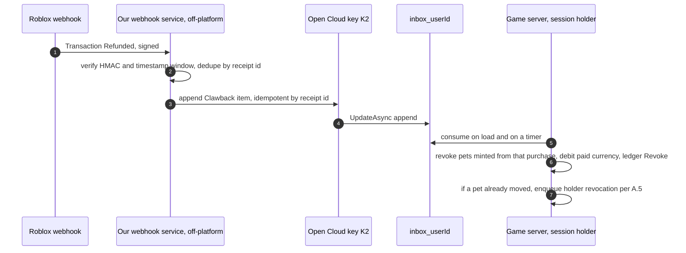

- **Receiver.** This is a small off-platform service. It verifies `roblox-signature` (HMAC-SHA256) and rejects requests
  outside the timestamp window. It dedupes by the transaction/receipt id, stores every event in the WORM archive (§7), and
  returns 2xx only after it has stored the event durably. Because duplicates and retries happen (F17), every step is idempotent.
- **Mapping to our grant.** *Verify in staging* that the webhook's receipt id equals `receiptInfo.PurchaseId`. Until that is
  verified, match on (buyer userId, productId, amount, time window), and send any ambiguous match to manual review.
- **Applying the clawback.** The game server consumes `Clawback{purchaseId}` from the restore inbox (§8). It never writes
  through Open Cloud into a live profile. In one profile `UpdateAsync` it does the following:
  1. It marks the profile's pets whose `mintRef == purchaseId` as `Revoked`.
  2. It debits Robux-bought currency (`coinsPaid`, A.3). Any shortfall goes to a non-negative `debt` field, so INV-6 still
     holds.
  3. It appends `Revoke` ledger entries.
  4. It records `clawbacks[purchaseId]` so the clawback is idempotent.
- **Pets already traded on.** The tool walks the ledger from each minted id to its current holder and handles the trade
  that moved it as follows:
  1. It reverses that trade **both ways** if the refunder still holds what they received.
  2. Otherwise it revokes from the current holder through that holder's inbox (A.5), and a dual-approved goodwill restore
     (`Source=Restore`) is considered for the innocent recipient. Recipients who were not party to the fraud are never left
     to absorb the loss silently. This mirrors the Adopt Me! 2022 cleanup, which spared people who "traded for duplicate
     pets" (AM-024).
- **Prevention beats cure.** Give paid-provenance pets (A.3) a configurable **tradability hold** after purchase. This
  follows Valve's precedent of holding or blocking newly purchased items (ECO-004, ECO-010). The docs do not state a refund
  window, so set the hold length from our own observed refund-timing data, not from a guess.
- **Consumer-protection guardrail.** Never ban or lock an account just because a refund or chargeback happened. FTC v. Epic
  barred locking accounts for disputing unauthorized charges (ECO-034). Remove the refunded benefit, and escalate only
  repeated patterns to human review.
- **Passes.** Roblox revokes pass ownership itself (F17). Any in-game items we granted *because of* a pass must be
  re-derived from ownership on join, or revoked by the same flow.
- **Ops dependency.** For a group-owned game, only group owners can configure the webhook (F17). Webhook delivery therefore
  depends on the owner account being secure (ASM-07). We found no verified pull API for refunds, so missed webhooks are a
  monitoring gap. Alert when the daily refund count is zero against a non-zero trailing baseline.

### A.2 Robux transfers (`PromptRobuxTransferAsync`) as an RMT rail (ASM-20)

- **Default for launch: do not couple transfers to items.** If we offer transfers at all (for tipping, for example), the
  pet trade system never reads transfer state. In-game text should say that we cannot enforce deals settled with transfers.
  That is the same position as Roblox's "we are not able to reverse it" guidance (ECO-018).
- **Receipts.** If transfers are enabled, register explicit `BindReceiptHandler` handlers for `RobuxTransferSender` and
  `RobuxTransferReceiver`. Each one records the transfer id in the profile and appends a `RobuxTransfer` ledger entry in one
  `UpdateAsync`, then returns `Processed`. That makes each receipt idempotent, just like §4. Do not grant anything.
- **If a pet-for-Robux market is ever built**, it counts as **paid item trading**:
  - Both parties must pass `IsPaidItemTradingAllowed` (A.3).
  - The pet goes into `EscrowOut` under a durable `Trades_v1` record keyed by the transfer request *before* the prompt.
  - The pet is released only when the receiver-side receipt is processed. Otherwise it is compensated at the deadline.
  - Parental-consent delays (F18) must not strand the pet. Use a long deadline, and show the "pending" state in the UI.
  - Disclose paid item trading in the Maturity & Compliance Questionnaire (OFF-038 notes).
- **Signals.** Flag pairs that exchange transfers and also make lopsided pet trades. This is RMT or trust-trade evidence for
  review, not for automatic bans.

### A.3 Paid-vs-earned provenance and `IsPaidItemTradingAllowed` (ASM-10, ASM-34, ASM-55)

- **`PetRecord.paid: boolean`** is set at mint and never cleared.
  - Set it for `Source=Purchase`.
  - Set it for `Hatch` or `Craft` when **any** input was paid: an egg bought with any `coinsPaid`, or any paid crafting input.
  - It travels with the record through trades and gifts.
- **Split currency.** Use `coinsPaid` (only from developer-product grants) and `coins` (earned).
  - The spend order (earned first or paid first) is a product and compliance decision. Get it reviewed.
  - Do not choose a spend order in order to dodge the policy.
- **Gate (server-side, per player, fail-closed).**
  - Read the policy on join with pcall and cache it for the session.
  - On error, treat `IsPaidItemTradingAllowed` as **false**.
  - A paid pet may be offered or received only if **both** parties are allowed.
  - Earned pets still trade normally.
  - We apply the restriction in both directions, sending and receiving. That is our conservative reading of "access the
    ability to trade", not a quoted rule.
- **Paid random items.** Keep odds in the server catalog, show numerical odds before purchase, and update them dynamically
  for luck boosts (OFF-037). When `ArePaidRandomItemsRestricted` is true, apply one of the documented treatments, such as
  hiding or blocking the paid egg or offering the earned path.

```lua
--!strict
-- SANDBOX/REFERENCE. Pure trade gate; callers pass session-cached flags (policy read once on join, fail-closed).
export type Flags = { paidTradingAllowed: boolean, tradeTierOk: boolean }
export type Switches = { tradingEnabled: boolean, frozenKinds: { [string]: boolean } }
local TradeGate = {}
function TradeGate.canMove(sw: Switches, from: Flags, to: Flags, pet: { kind: string, paid: boolean? }): (boolean, string?)
	if not sw.tradingEnabled then return false, "TradingDisabled" end          -- A.6 kill switch
	if sw.frozenKinds[pet.kind] then return false, "KindFrozen" end
	if not (from.tradeTierOk and to.tradeTierOk) then return false, "TierGate" end -- A.4
	if pet.paid and not (from.paidTradingAllowed and to.paidTradingAllowed) then
		return false, "PaidTradingNotAllowed"                                   -- F19
	end
	return true
end
return TradeGate
```

Call `TradeGate.canMove` for every pet in `setOffer` **and again in `prepare`**, because flags and switches can change
between the two calls.

### A.4 Age and verification gates (ASM-46, ASM-23)

- `tradeTierOk` is a server-computed, configurable rule. It can combine `Player.AccountAge` with a playtime threshold, which
  matches Adopt Me!'s 2-hour rule (AM-035), plus optional `IsVerified()` or a checked `AgeChecked` status for high-value
  tiers or for any Robux-transfer feature.
- We found no evidence that Adopt Me! gates in-game trading on age checks (AM-038, UNVERIFIED). Gating is therefore our
  choice, not an industry norm. Keep it behind config, measure the false-positive cost, and never require chat (chat is off
  for self-declared Select accounts, OFF-040).
- These values are read on the server only. `IsVerified()` returns false in Studio (F20), so tests must inject flags.

### A.5 Two-sided rollback and restore policy (ASM-17, ASM-18, ASM-38, ASM-39); corrects §8

1. **Freeze first.** On an ATO claim, freeze the claimant's tradability. We cannot see the cause, which is at the Roblox
   account layer.
2. **Compute the reversal set from the ledger.** That is every trade and gift by the claimant inside the claimed compromise
   window.
3. **Reverse each trade both ways.** Return the claimant's outgoing items **and** the counterparty's items. A counterparty
   who traded fairly must never end up net-negative. This is the one-sided rollback abuse in ECO-028 and RBX-039, and
   Valve's "reverse all trades" model (ECO-011) is the precedent.
4. **Items that moved on** are revoked from their current holders. A holder who was not party to the fraud gets a reviewed
   goodwill restore.
5. **Limits.** Allow one restore per account per policy period (AM-021, ECO-029). After a reversal, apply a trade cooldown
   (ECO-011 reports 30 days). Require dual approval (§8), and cap restores per agent (§11).
6. **Revocation lookup (replaces "sees the revocation on load").** Per-pet lookups on load are not budget-safe (F5). Instead:
   - the support tool resolves the **current holder** from the ledger export and writes `Revoke{petId}` to that holder's
     `inbox_<userId>`, which is consumed through the single path on load;
   - `Revocations_v1` stays the audit record;
   - a nightly scan asserts that no revoked id is `Owned` anywhere (INV-9) and pages on-call if one is.

### A.6 Trading and gifting kill switch (ASM-11, ASM-37, ASM-44)

- **Where the switch lives.** It is a durable config key, `Config_v1/economy`, holding `tradingEnabled`, `giftingEnabled`,
  `hubEnabled`, `frozenKinds`, `mintPaused[source]` and `productPromptsEnabled[productId]`.
- **How servers read it.** Every server reads it with `UseCache=false` (F5) every 30–60 s. A MessagingService "refresh now"
  nudge speeds this up, but the nudge is best effort, so the periodic read is the guarantee (F10).
- **Semantics.**
  - Disabling blocks **new** `Proposed→Locked` and `Locked→Confirmed` transitions, and aborts in-memory trades in
    Proposed or Locked.
  - Trades already in `Committing` **always run to a decision** through §6.2 and `recover()`. Stranding a trade mid-saga is
    worse than letting it finish.
  - Disabling a product hides its prompt only. Receipts for purchases already paid are still processed (§4). Refusing a
    paid receipt is not a kill switch.
- **Fail-safe.** If the config is unreadable for longer than N minutes, treat trading and gifting as disabled. Trading needs
  healthy DataStores anyway.
- **Change control.** Flipping the switch is a dual-approved, audited ops action through a scoped Open Cloud key (§9). The
  on-call runbook says "freeze first, investigate second". That matches every precedent we found (AM-016, AM-018, RBX-025,
  RBX-031).

### A.7 Never save after a failed load (ASM-01, ASM-37)

- **Session states.**
  - `Loaded` is reached only when the load `UpdateAsync` returned successfully.
  - `Errored` covers read errors, a foreign lock, a newer schema (§3) or a stolen lock.
  - A **new player** is recognized only from a *successful* read that returned `nil`. A failed read never means "new player".
- **What `Errored` blocks.** Autosave, PlayerRemoving save, BindToClose save, purchases (`NotProcessedYet`), trades, gifts
  and inbox consumption. Show "your data is unavailable, rejoin later" and kick after a grace period.
- **Shrink guard.** Before any save, compare the pet count and the paid and earned balances against the loaded snapshot
  plus the ledger ops in this session. Refuse a save that drops more than the ledger explains. Mark the session errored and
  alert. This catches "save defaults over real data" bugs that evade the state flags (RBX-009 class; mechanism from OFF-027).

### A.8 Gifting, crafting and event currency (ASM-21, ASM-22, ASM-27, ASM-28, ASM-33)

- **Gift = trade with an empty counter-offer.** It uses the same §6 state machine, the same coordinator record, the same
  `recover()`, and the same A.3, A.4 and A.6 gates. There is no separate "delete here, add there" path. The Grow a Garden
  gifting dupe (RBX-031) is the class this prevents.
- **Crafting.** Add `"Craft"` to `Source`, using `ref = hash(sorted consumed ids)`. Consuming the inputs and minting the
  output happen in **one** in-memory mutation, persisted by one `UpdateAsync`. `paid` is the OR of the inputs' flags.
- **Event currency.**
  - Rewards are computed by the server from server-observed state, never from a client score.
  - Apply a per-user per-day cap and a per-minigame plausibility ceiling (maximum achievable rate).
  - Event currency is untradeable and expires with the event (AM-034: caps plus bans until the currency expired).
  - World-interaction rewards (ProximityPrompt, ClickDetector, Touched) re-check distance and state on the server, and use
    server-owned or anchored parts (OFF-007, OFF-008).

### A.9 Reference-code correction for `TradeService.recover` (ASM-12)

`readRecord` must distinguish "**absent**" from "**read failed**". Change its contract to `(ok: boolean, rec: any?)`.

- On `ok == false`, leave items frozen and retry on the 30 s timer.
- Only `ok == true and rec == nil` means presumed abort. That is safe because §6.2 creates the record before any prepare.

The same rule applies to `cas()`, which already returns `nil` on failure.

### A.10 Owner, collaborator and tooling hardening (ASM-07, ASM-08, ASM-25, ASM-26)

- **Release provenance.** CI records place version ↔ commit SHA for every publish. A scheduled job compares the live prod
  place version against the CI record, and any publish CI did not make pages on-call. That is the RBX-019 hijack signal.
- **Accounts.** The group owner is a dedicated account with 2SV and is not used for daily work. Prod publish rights are
  limited to 2–3 people. Review the collaborator list monthly.
- **Tooling.** Commit lockfiles and pin versions (`npm ci`). Keep an allowlist of tooling packages with no `postinstall` in
  CI. Keep Open Cloud keys out of developer machines (Secrets Store or CI secrets only). These controls target the noblox.js
  typosquat class (RBX-016/017/018).
- **Content.** The CI lint fails on `require(<number>)`, `loadstring` and `getfenv`/`setfenv` anywhere outside an
  allowlist, and on any Script inside imported models (RBX-021, RBX-023, OFF-035).

### A.11 Additions to the P0 checklist (§14)

- [ ] Refund webhook receiver is live: HMAC verified, idempotent, feeding the inbox; clawback handles pets that were traded on (A.1).
- [ ] `paid` flag and split currency exist; the `IsPaidItemTradingAllowed` gate is fail-closed and checked at offer and at prepare (A.3).
- [ ] The kill switch works without a deploy; Committing trades still resolve (A.6).
- [ ] Errored sessions never save; the shrink guard is active (A.7).
- [ ] Gifts and crafting go only through the saga and single mint path (A.8).
- [ ] `recover()` distinguishes a read failure from an absent record (A.9).
- [ ] The release-provenance check is running (A.10).
