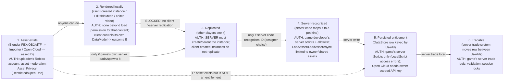

# External asset import reality check (prefix IMP-)

Execution date: 2026-10-19. Read-only research. No scripts, executors, place files or samples were fetched or described.

## Method and access limits (read first)

- `create.roblox.com` was **blocked by the egress proxy** (HTTP 403 on CONNECT). WebFetch also failed DNS for every host
  (devforum.roblox.com, khronos.org, wikipedia.org).
- Workaround for primary docs: a sparse clone of the **official Roblox docs source repo** `github.com/Roblox/creator-docs`
  at commit `70a0110fee0c0900103e545fcaee69a8bd2a942f` (commit date 2026-10-17, "update Open Source Docs from Roblox internal teams").
  This repo is the source that create.roblox.com/docs renders. All doc quotes below are **verbatim from that source**. The
  create.roblox.com URL is listed as the canonical URL, and the GitHub blob is listed as the archive/verification URL.
- DevForum, wiki and press items: **search-engine snippets only** (WebSearch). Page bodies were not opened, so post dates are mostly
  unverified. Ledger rows mark these as `failed(WebFetch DNS; search snippet only)`.
- Many search hits for "Adopt Me fake pets / duplicator / steal script" came from **SEO-spam mirror domains** (monitoring.toky.co,
  nwww.arktimes.com, worker-monitor.api.hlthd.tsl.io, rustdesk.crownring.com, smtp.compagnie-des-sens.fr, etc.). These are
  **excluded as evidence**. They are recorded only as a negative-quality signal.

GH = `https://github.com/Roblox/creator-docs/blob/70a0110fee0c0900103e545fcaee69a8bd2a942f/content/en-us/`

---

## Bottom line

Uploading a Blender model to Roblox creates a **cloud asset ID that the uploader owns**. It does **not** create a pet in someone
else's game. In a typical pet game, a pet is a server-written record in that game's DataStore, keyed by UserId. Only that game's
server scripts can write that record. An asset ID, a catalog item, or a client-rendered model does not create the record. The
only legitimate way an external asset becomes an in-game item is that the **game's own developers** decide to recognise it, for
example through PlayerOwnsAssetAsync, in-game creation, or reading catalog ownership. That is a designer choice inside the
trust boundary.

No evidence found that Adopt Me! has a player pet-import or UGC-pet feature (searched; nothing found; spam sites excluded).

---

## 1. Legitimate pipeline (Blender -> Roblox asset)

**Importer formats.** `studio/importer.md`: "Importer imports third-party .fbx, .gltf, and .obj 3D model assets into Studio."
"You can import meshes in the `.fbx`, `.obj`, or `.gltf` format. The `.fbx` and `.gltf` formats support multiple mesh objects and
hierachies, basic and PBR textures, cage mesh objects, rigs, avatar components, animation data, and vertex colors."
- URL: https://create.roblox.com/docs/studio/importer (GH: studio/importer.md)
- **glTF import date: UNVERIFIED.** A Khronos news item, "Roblox Announces 3D Importer Support for glTF Files (Beta)"
  (https://www.khronos.org/news/permalink/roblox-announces-3d-importer-support-for-gltf-files-beta), says the beta covered "3D mesh
  models and PBR textures" and planned rigging/skinning/animation later. The DevForum "3D Import Recap Aug-Oct" (2023; t/2701407)
  refers to glTF fixes. The "3D Import Recap Mar-Apr 2024" (t/2979668) says Open Cloud 3D import supports glTF/glb. Together these
  bound the glTF import beta to **on or before late 2023**, but the exact date was not read. The "3D Importer [Full Release]"
  thread is t/2057539. glTF **export** is a separate, later beta ("glTF Export Beta Available Now", t/3905928; docs still mark it beta).

**Asset IDs.** `parts/models.md`: "When you upload or import a `.gltf`, `.fbx` and `.obj` model file to the cloud using the Importer,
Roblox represents it as a cloud-based asset with a unique corresponding ID."

**Open Cloud Assets API.** `cloud/guides/usage-assets.md` lists Model uploads accepting `.fbx`, `.gltf` (`model/fbx`,
`model/gltf+json`, `model/gltf-binary`). It "Imports custom 3D models as a `Class.Model` container containing one or more
`Class.MeshPart` objects." It also notes "Models upload as packages". The responses include `moderationResult.moderationState`. Scopes
are `asset:read` / `asset:write`. Limit: "one asset with the file size up to 20 MB".

**Moderation.** `projects/assets/index.md`: "Roblox performs both human and automated asset moderation on a proactive and reactive
basis ... This process generally happens within a few hours after you import the asset. If an asset is still in the moderation
queue when you publish your game, users cannot see or interact with the asset until Roblox approves it."

**Asset privacy / permissions.** `projects/assets/privacy.md`:
- Two types. "**Restricted** — Creators or games can only use the asset after the asset owner grants permission." "**Open Use** —
  Any creator or game can use the asset."
- "Asset Privacy controls only the default privacy state assigned to **Images**, **Decals**, and **Meshes** when they are created.
  ... Audio, Video, Models, MeshParts, Animations, and Packages — these types have their own creation defaults."
- "By default, Images, Decals, and Meshes are created as **Open Use**." Also: "Open Use is irreversible." "Game grants are permanent."
- "The asset privacy system controls which creators and games can use the asset, but others can still see its metadata."
- Dates: the DevForum "Expanded Sharing for Assets" (t/3641687) describes "the first of three launches for asset privacy and
  permissions". The opt-in privacy for images/decals/meshes came later. **Exact launch dates are UNVERIFIED.** The brief's "2024 asset
  permissions system" is not confirmed by what was read. The thread ID range suggests 2025. Audio privacy was an earlier separate
  change (t/1701697).
- **Implication:** permissions control whether a game *can load* the bytes. They say nothing about whether a game *grants an item*.
  A mesh being Open Use means anyone can render it. It still does not become an inventory item anywhere.

**Packages.** `projects/assets/packages.md` covers versioning, `PackageLink.AutoUpdate`, and "View the full version history for a
package, compare versions, and restore old versions". It also warns: "Be careful when inserting assets that you didn't create into
your games, as they can contain malicious scripts."

**Creator Store / third-party models.** `scripting/security/third-party-vulnerabilities.md`: "Third-party assets from the Creator
Store (Toolbox) are a common source of security risks, as they can contain malicious scripts called backdoors. These scripts give
their creators unauthorized server-side access to your game". Also: "Roblox moderates Models for malicious scripts ... but this process
is not guaranteed to remove all such scripts." **This is the real way an "uploaded asset" can affect a server: when the developer
inserts it.** It is a supply-chain risk, not a player import.

**UGC / Marketplace (avatar items).**
- Eligibility (`marketplace/frequently-asked-questions.md`): "Creators who are ID-verified, have Roblox Plus or Roblox Premium 1000 or
  2200 ... can upload, publish, and sell in Marketplace." Also "Roblox also requires a publishing advance for all items published on
  Marketplace, with the exception of free Limited items." The legacy UGC Program application is being sunset.
- Fees (`marketplace/marketplace-fees-and-commissions.md`): "Pay an upload fee of **80 Robux** per submission. Items that use an
  emissive mask require an upload fee of **500 Robux** instead." Also: "upload fees are not refunded if an item is rejected".
- Validation (`marketplace/validation-system.md`): "The UGC validation system is Roblox's technical mechanism that checks if avatar
  assets meet platform specifications before you can upload and publish them to the Marketplace." It also runs for in-experience
  `AvatarCreationService`.
- Moderation (`marketplace/moderation.md`): review "can take up to 24 hours". Removed items with sales are refunded.
- **The output is an avatar accessory in the user's Roblox inventory. It is not a row in any game's DataStore.**

## 2. Runtime loading

**InsertService:LoadAsset** (`reference/engine/classes/InsertService.yaml`): "To load an asset, it must be accessible by the creator
of the experience loading it ... Should an experience be uploaded by a different creator, the asset data would not be accessible."
Security check: "The asset must be **created or owned** by the game creator. The asset must be **shared** by the asset owner. The
asset must be owned by Roblox. Additionally, benign asset types such as t-shirts, shirts, pants and avatar accessories are loadable
from any game as they are `OpenUse`."

**AssetService:LoadAssetAsync** (modern replacement). It can load third-party public free Creator Store assets only if the
experience owner turns on **Allow Loading Third Party Assets** (`AssetService.AllowInsertFreeAssets`, default false; property writable
only via "Studio's Experience Settings"). "The returned `Class.Model` is sandboxed by default (`Sandboxed` is `true`) and has no
script Capabilities." **So a random uploader cannot force a game to load their model. The game's own server code must call the load,
and the game owner controls the setting.**

**CreateMeshPartAsync.** "creates a MeshPart with a specified mesh ID ... through scripts". It is a runtime way for *the game's
code* to show a mesh. Mesh access is still subject to privacy for Restricted meshes.

**EditableMesh / Mesh & Image APIs** (`EditableMesh.yaml`): "using `EditableMesh` fails by default in published games. To enable it
... toggle on **Enable Mesh / Image APIs**". Permissions: CreateEditableMeshAsync loads only meshes "Owned by or explicitly shared
with the game owner ... the logged in Studio user ... the logged in player if the `EditableMesh` is on the client side ... [or] a group
where [they have] permission". The class is tagged `NotReplicated`.
- Dates: Studio beta "Introducing in-experience Mesh & Image APIs [Studio Beta]" (t/2725284). The search snippet cites a 2024-09-25
  update saying the APIs are not usable in published experiences yet. A later 2026 beta ("EditableMesh Batching APIs", t/4779401) lists
  "enabling replication and permissions restrictions" as open items. A search snippet says enabling requires 13+ age verification and
  ID verification (not found in the doc source read; **UNVERIFIED**). Exact GA date for published experiences: **UNVERIFIED**.

**Client-local rendering.** A client fully controls its local DataModel. `scripting/security/security-tactics.md` says an exploiter
can "Change anything in their local DataModel without firing any expected events". Client-created instances are visible only to that
client. DevForum community answers say a clone made in a LocalScript "will not replicate to everyone" (community, not official).
`EditableMesh` is `NotReplicated`. So a client can *show itself* a model built from any loadable content (outcome **E**). Nothing
replicates to the server or other players. The server only accepts input through remotes and validates it there
(`security-tactics.md`: "all critical logic must be validated server-side or run exclusively on the server").

## 3. Entitlement boundary

| Link | Official support |
|---|---|
| Pet inventory lives in a DataStore | `cloud-services/data-stores/index.md`: "store data that needs to persist between sessions, like items in a player's inventory". |
| Keyed by UserId | Same page: "A unique **key** indexes each value in the data store, like a user's unique `Player.UserId`". |
| Server-only writes | Same page: "The server can only access data stores through Scripts. Attempting client-side access in a LocalScript causes an error." |
| Scoped to one game | "Data stores are consistent per game, so any place in a game can access and change the same data". Another game's server, and an uploader's account, have no handle on it. |
| Server is source of truth | `security-tactics.md`: "The server must be the ultimate source of truth for all simulation states, rules, player progression". Its example: "the server populates that player's inventory" (`projects/client-server.md` figure caption). |
| Open Cloud DataStore access | Requires an API key from the game owner with game-scoped operations (`cloud/auth/api-keys.md`). |

**Catalog ownership is not game inventory.** Platform ownership APIs exist: `MarketplaceService:PlayerOwnsAssetAsync` ("Returns
whether the given user has the given asset"; the old `PlayerOwnsAsset` is deprecated) and `UserOwnsGamePassAsync` ("You can use this
method on both the client and the server"). A game only maps those to in-game items if **its designers write code that does so**.
**Risk if a game does map catalog ownership to items:** anyone who can publish or acquire a matching catalog asset, or a lookalike
under the developer's mistaken ID list, can mint the in-game item. Mitigations: map only asset IDs created by the developer's own
user or group, and pin them in a server allowlist. Treat the ownership check as an entitlement source with the same audit trail as a
purchase. Never call it client-side for granting.

## 4. How "fake pet" demos are produced (architecture level only)

| Technique | Classification | Evidence quality |
|---|---|---|
| Client-side instance creation / local UI edit (only the viewer sees it) | E | Mechanism confirmed by Roblox docs (local DataModel control; no replication). No primary Adopt Me debunk post read. |
| Edited screenshots / videos ("staged gameplay, inserted game sounds, slow motion") | E/H | Only from SEO-spam pages (excluded). The marix.app scam list mentions "edited screenshots" as fake proof (low authority). |
| Private servers of copied / leaked place files, or lookalike test experiences mimicking UI | E (in that copy) / H (claim of real pet) | Rests on saveinstance threads (below) and the Adopt Me fandom wiki description of separate "Adopt Me items" games that phish for Robux/passwords. Specific named clones were not found. |
| External Blender model uploaded and shown in own/test place | F | Mechanism confirmed by docs: asset ID ≠ entitlement. |
| "Duplication/cloning" service claims | H (scam) | Fandom/third-party guides say "cloning is not possible in Adopt Me! and this is a scam". This is corroboration only. |

Searches that found **nothing usable**: a Reddit thread about a client-sided fake-pet video; YouTube debunk videos by named
creators; an official Uplift statement debunking fake-pet videos. Search results were dominated by SEO spam.

## 5. Place-file theft / saveinstance

- `scripting/security/access-control.md`: "Any `LocalScript`, `Script` with `RunContext::Client`, or `ModuleScript` can be
  decompiled by an exploiter once replicated to their client ... Server-only Scripts and ModuleScripts stored in `ServerStorage` or
  `ServerScriptService` cannot be decompiled as they never replicate to clients." It also says: "Any content that replicates to a
  client can be extracted and data-mined by an exploiter."
- `ServerStorage.yaml`: "Objects descending from ServerStorage will not replicate to the client". `ServerScriptService.yaml`: "The
  contents are never replicated to player clients at all".
- Subplaces leak: "Exploiters have the ability to access 'restricted' places within your universe if they can join a single place
  ... This can also lead to the unintended leak of unreleased content, for example from a development or staging game." Fix: **Access
  Control for Places → "Secure within universe only"**.
- DevForum "Theft of Game Content Using saveinstance()" (t/3050674; snippet): replies say exploits download "everything the client has
  access to. Nothing that exists only on the server can be stolen this way". Community consensus.
- **Meaning:** leaked UI, models, and client modules let someone build a *convincing visual replica* (E) or a lookalike private game
  (E/H). They do **not** contain or grant the original game's server inventory (no DataStore access, no server scripts).

## 6. Game-specific UGC / import features

- **Roblox platform:** in-game asset creation exists (`projects/assets/in-experience-asset-creation.md`). Its own example: "you can
  enable users to create custom creatures as pets in your game, and allow them to save their favorite pets to their inventories".
  Limits: "Currently, you can only allow users to create packages ... can't contain any scripts or private assets". It runs from "a
  server-side script" via `AssetService:PromptCreateAssetAsync()` and is subject to moderation. **The game controls this and it stays
  inside that game's trust boundary.** It saves to the user's Roblox inventory. Whether the game treats it as a pet is again the game's
  own server logic.
- **Specific games where players import custom pets:** none verified (searches returned spam / unrelated).
- **Adopt Me!:** no evidence of a player UGC or pet-import feature. Searches returned licensing/toy news (Jazwares, WowWee
  Fingerlings 2024, Creative Kids) and spam. Toy codes unlocking in-game items are reported by press (pockettactics, low detail). That
  is a developer-controlled redemption path, not asset import. **Status: UNVERIFIED-absent (no positive evidence).**
- **Developer test pets / debug tools leaking:** nothing verified for Adopt Me. A 2021 digistatement article on exposed unreleased data
  appeared in snippets only (low authority). The docs' generic warning about staging/subplace leaks applies.

## 7. Provenance controls for our game

1. **Server-side allowlist** of pet definitions: `petKind -> {meshAssetId, textureIds, version}` in ServerScriptService/ServerStorage.
   The server only grants kinds in the table. The client sends kind IDs, never asset IDs. Reject unknown IDs and log them.
2. **No runtime third-party loading:** keep `Allow Loading Third Party Assets` OFF. Avoid `LoadAssetAsync` with player-supplied IDs.
   Keep Mesh/Image APIs OFF unless needed. If loading is needed, use own-group-owned IDs only and rely on the default `Sandboxed` model.
3. **Asset ownership:** create all pet meshes under the studio group. Enable Asset Privacy (Restricted on creation) for new
   meshes/images. Remember Open Use is irreversible and game grants are permanent.
4. **Packages with version pinning:** keep `AutoUpdate` off for production-critical packages. Review package version diffs in PRs.
5. **CI content hashing:** Rojo file-system-first source (docs recommend Rokit-pinned `rojo-rbx/rojo@7.6.1` style). Hash the
   asset-ID manifest and the built `.rbxl`. Fail CI if the manifest changes without review. Publish via Open Cloud place publishing
   API from CI. The docs suggest "call this API from a GitHub action". (Note: the place publishing API does not update
   EditableMesh/SurfaceAppearance instances.)
6. **Signing / attestations:** Roblox provides no artifact signing. Sign/attest the built place file and manifest in CI
   (e.g., Sigstore/SLSA-style provenance) and record the published place version ↔ commit SHA. This is our own control (Generic).
7. **Open Cloud API keys:** "Restrict by Experience", minimal operations, IP restriction (not for keys used inside Roblox places),
   expiration dates, and store keys in the Secrets Store. Keys auto-expire after 60 days unused. Use a dedicated low-privilege alt for
   group resources.
8. **Third-party models:** sandbox them and grant no DataStore/Network/LoadString capabilities.
9. **Subplace security:** "Secure within universe only" so staging/test places with debug pets can't be joined or datamined.
10. **Catalog-to-item mapping (if ever used):** server-only, allowlisted creator IDs, idempotent grant ledger.

## Mermaid chain diagram

Outcome mapping: stopping at A = **F**. Stopping at B (shown in a video or screenshot) = **E**. Claiming F or E is a real pet = **H**.
Only E->F executed by the game's own server = **A/B**. Bypassing D/E server checks would be **C/D**. That is out of scope here, and no
such path via asset import was found.
